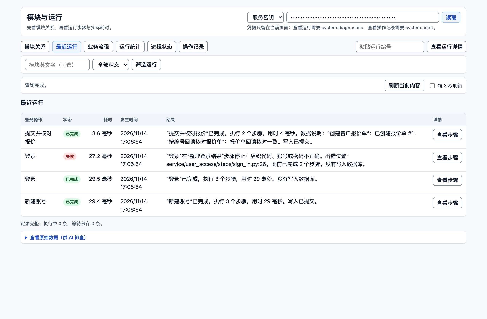
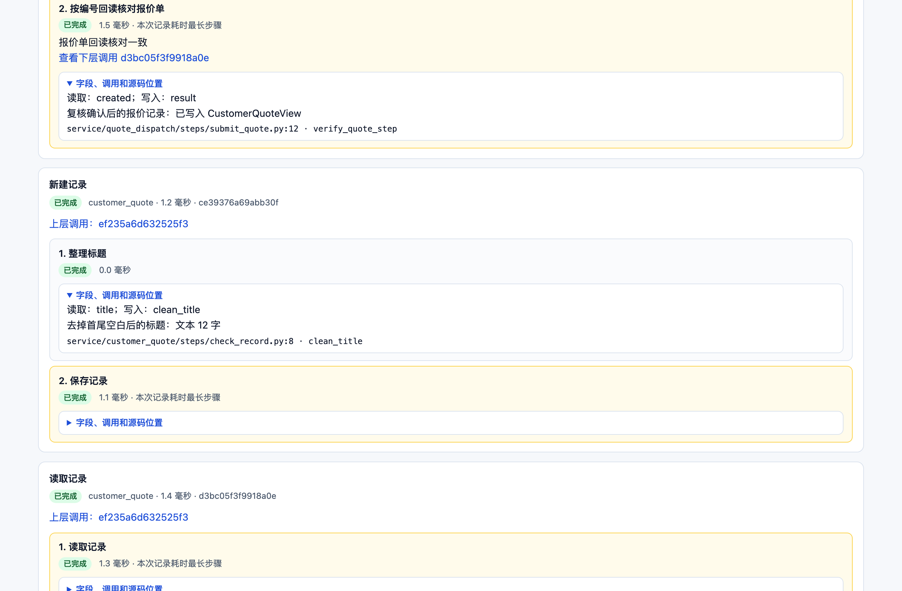
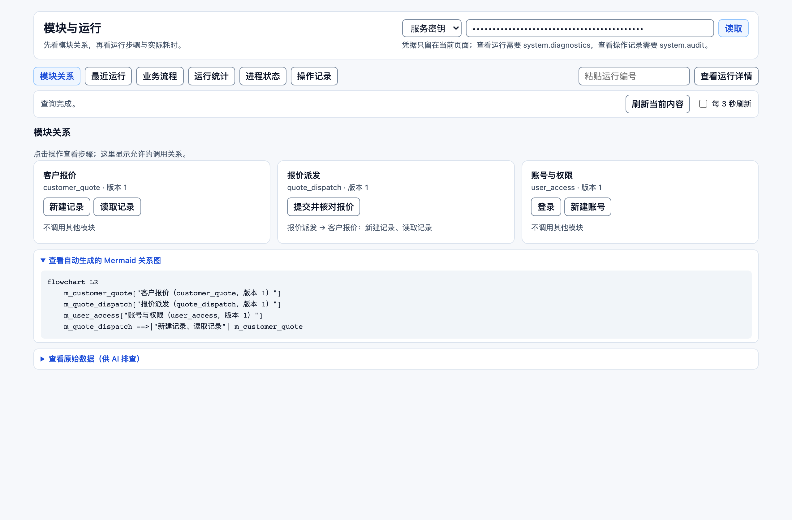
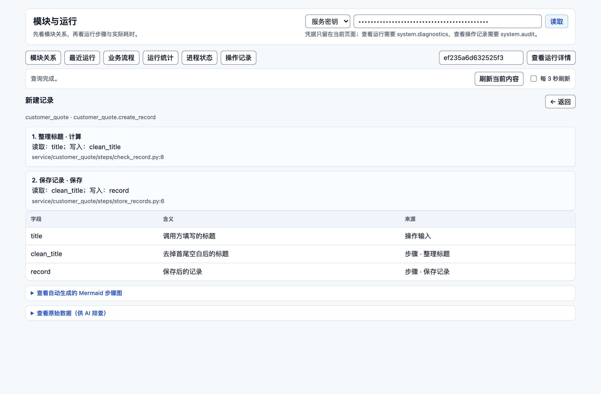

# FastAPI Business Backend Template

[](CHANGELOG.md)
[](LICENSE)
[](server/pyproject.toml)
[](doc/architecture.md)
[](doc/deployment.md)
[](doc/verification.md)
[](AGENTS.md)

[简体中文](README.md) | **English**

An enterprise-grade **FastAPI modular monolith template** built for **Human + AI Agent collaborative engineering** (Claude Code, Codex, Cursor, Antigravity, and others). It ships with zero pre-bundled domain bloat: humans review business rules and contracts, AI agents implement modules inside strict architectural boundaries, and the framework enforces step-level field isolation, write-transaction ordering, multi-tenant SQL checks, database-backed background jobs, unknown-result protection for external writes, and end-to-end execution reports.

> **Full-Stack Companion**: Use this backend standalone or pair it with **[vue3-business-template](https://github.com/mumuxsy/vue3-business-template)**. Both templates share OpenAPI contract diffing, preset `/api/v1/access` authentication conventions, end-to-end `X-Run-ID` correlation, and one-command isolated full-stack acceptance testing.

---

## Why This Template Exists

Conventional backend starters only give you folder boilerplate. Under sustained iteration and multi-agent coding, four failure modes quickly appear:

1. **Eroding module boundaries**: Cross-module table joins and private imports turn small schema changes into repo-wide breakages.
2. **External I/O inside DB write transactions**: Calling slow HTTP APIs or LLMs mid-transaction exhausts connection pools, while naive retries trigger duplicate charges or duplicate notifications.
3. **Opaque production failures**: A `500` error forces engineers to dig through unstructured text logs without knowing which step stopped, what intermediate values were computed, or whether any write committed.
4. **Dead-end template forks**: Once product code mixes with starter code, upstream concurrency and security fixes become impossible to merge.

`fastapi-business-template` turns architectural discipline into **startup validation, AST import enforcement, and a declarative step runner**, paired with a provenance-based three-way upgrader (`uv run dev upgrade`) that updates framework files without touching product modules.

---

## Built-in System Troubleshooting Console

Enabled by default in local development at `/system/console` (captured from live generated modules):

| Recent Runs & Source-Line Diagnostics | Cross-Module Call Tree, Slowest Step & Field Diffs |
| --- | --- |
|  |  |
| **Module Dependency Boundaries & Auto-Generated Mermaid Graph** | **Declared Steps & `meaning()` Field Lineage** |
|  |  |

---

## Key Capabilities

### 1. Enforced Modular Monolith Boundaries
- **Three explicit package roles**: **Capability modules (`capability`)** own tables exclusively and may only call declared `query` dependencies across modules; **Workflow modules (`workflow`)** own zero tables and orchestrate cross-capability commands; **Libraries (`library`)** contain pure stateless computation.
- **AST import & SQL ownership checks**: Modules only import `public.py` from peers; `FastAPI` and `httpx` stay out of business packages; SQLAlchemy Core queries live strictly inside `store/`.

### 2. Declarative Step Runner & Transaction Ordering
- **Step-level read/write field isolation**: Every `@step` declares `reads=[...]` and `writes=[...]`. Undeclared reads/writes or float monetary values (`Decimal` required) fail immediately.
- **Read -> External Call -> Save ordering**: Read-only steps run before any write transaction opens. The first `saves=True` step begins the write transaction, after which external HTTP calls and LLM prompts are forbidden; all writes commit atomically or roll back together.
- **Self-documenting schemas (`meaning()`)**: Every `Data` and `WorkData` field declares its purpose, unit, and null semantics via `meaning()`, feeding both OpenAPI schemas and runtime diagnostics.

### 3. Multi-Tenancy, Query Budgets & Field Encryption
- **Row-level tenant & owner verification**: Tables using `org_column()` or `owner_column()` are verified across every query, subquery, and update before execution; missing tenant predicates are rejected.
- **Per-operation `QueryBudget`**: Caps SQL query count, returned rows, bytes, and repeated queries per contract—failing fast in tests to prevent N+1 regressions.
- **Built-in `Vault` & redaction**: Symmetric field encryption with key rotation (`APP_DATA_KEYS`) and automatic redaction for `secret=True` fields across logs and run records.

### 4. Database-Native Job Queue, Segmented Batches & Pipelines
- **Transactional job enqueueing**: Enqueue background jobs via `later` inside the same database transaction with idempotency `key`, retry schedules, shared `ResourceLimit`, per-key serialization (`SerialKey`), pre-execution `revalidate`, and cron-like `Schedule`.
- **Segmented jobs & multi-stage `Pipeline`**: Cursor-based batch checkpoints (`segmented=True`), resumable multi-stage workflows (`Stage` / `Wait`), and parallel `FanOut` aggregation—without requiring external message brokers.

### 5. Safe External Side Effects & Versioned LLM Prompts
- **Unknown-result safety**: Timed-out or `5xx` external write calls (`effect="write"`) return `UNKNOWN_RESULT` without blind retries; SMTP/SDK side effects use `ProviderSpec` outbox records.
- **Structured LLM calls**: Versioned Markdown prompt templates in `prompts/` with typed `model.ask_data(...)` validation, local mock fallback, and SSE streaming with automatic rollback on client disconnect.

### 6. Tooling, TLA+ State Verification & Three-Way Upgrades
- **19 `uv run dev` commands + 5 built-in Agent Skills**: Scaffolding, semantic code search (`dev locate`), live operation runner (`dev run`), OpenAPI export & compatibility diffing (`compare-api`).
- **4-layer verification + TLA+ (`JobCommit.tla`)**: Module quick checks, Git-affected selection, 100% registered-contract execution check, PostgreSQL 17 concurrency tests, isolated HTTP acceptance server, and formal state-space verification of concurrent worker job commits.
- **History-free three-way framework upgrade**: `uv run dev upgrade` compares old template, new template, and product files via `template-source.json` digests—aborting cleanly on conflicts while keeping business packages untouched.

---

## Quick Start

### Prerequisites
- Python `3.12` or `3.13`
- [uv](https://docs.astral.sh/uv/) package manager
- SQLite out of the box for local dev; PostgreSQL 17 for production and lock/numeric precision tests

### 1. Run the Template Locally

```bash
cd server
uv sync --locked
test -f .env || cp .env.example .env
uv run alembic upgrade head
uv run uvicorn app.setup.web:create_app --factory --reload --no-access-log
```

- Readiness check: `http://127.0.0.1:8000/health/ready`
- OpenAPI UI: `http://127.0.0.1:8000/docs`
- System Console: `http://127.0.0.1:8000/system/console` (generate a local service key via `uv run dev make-key --name local --org-id '*' --permissions '*'` and add its config entry to `APP_API_KEYS` in `.env`)

### 2. Initialize a Clean Product Repository

```bash
cd server
uv run dev new-project /abs/path/my-product-backend --name "Order Fulfillment Service"

cd /abs/path/my-product-backend/server
uv sync
cp .env.example .env
```

Initialized products start cleanly at `0.1.0` with `template-source.json` provenance and **do not copy** this template's `LICENSE`, community governance files, GitHub issue templates, or showcase screenshots.

### 3. Generate Modules, Run Operations & Verify

```bash
# 1. Generate the preset authentication module (aligned with vue3-business-template)
uv run dev new-module user_access --title "Accounts & Access" --preset access
uv run alembic upgrade head

# 2. Generate a capability module and create its migration
uv run dev new-module customer_quote --title "Customer Quotes"
uv run alembic revision --autogenerate -m "add customer_quote tables"
uv run alembic upgrade head

# 3. Execute a real operation from CLI and inspect the step-by-step report
uv run dev run customer_quote.create_record --input '{"title": "Annual Enterprise Quote"}' --allow-write

# 4. Export OpenAPI schema and run delivery-grade verification
uv run dev docs
uv run dev check --delivery
```

---

## Documentation & Governance

 Primary engineering documentation and built-in Agent Skills are written in concise Chinese to match the framework's Chinese runtime diagnostics and domain rule workflow:

- **Developer & Agent Entry**: [AGENTS.md](AGENTS.md)
- **Design Rationale**: [design/backend-template.md](design/backend-template.md)
- **Architecture & Development**: [doc/architecture.md](doc/architecture.md) · [Framework Reference](.agents/skills/fastapi-module/references/framework.md)
- **Verification & TLA+ Model**: [doc/verification.md](doc/verification.md)
- **Docker Compose Deployment & Operations**: [doc/deployment.md](doc/deployment.md)
- **Community & Security**: [CONTRIBUTING.md](CONTRIBUTING.md) · [SECURITY.md](SECURITY.md) · [CODE_OF_CONDUCT.md](CODE_OF_CONDUCT.md) · [CHANGELOG.md](CHANGELOG.md)

---

## License

Released under the [MIT License](LICENSE). Downstream products created via `uv run dev new-project` do not inherit this `LICENSE` file by default, allowing you to choose any proprietary or open-source license for your own product.
