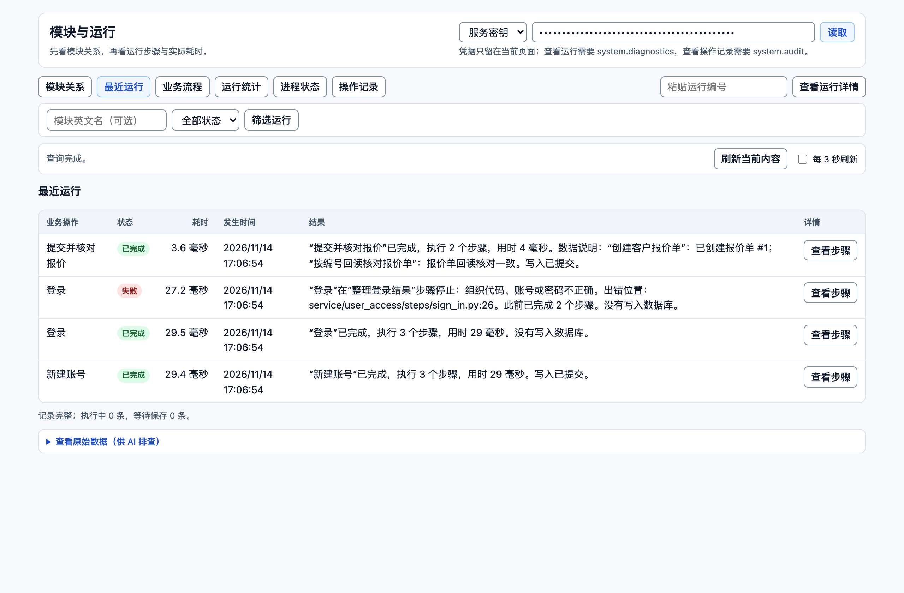
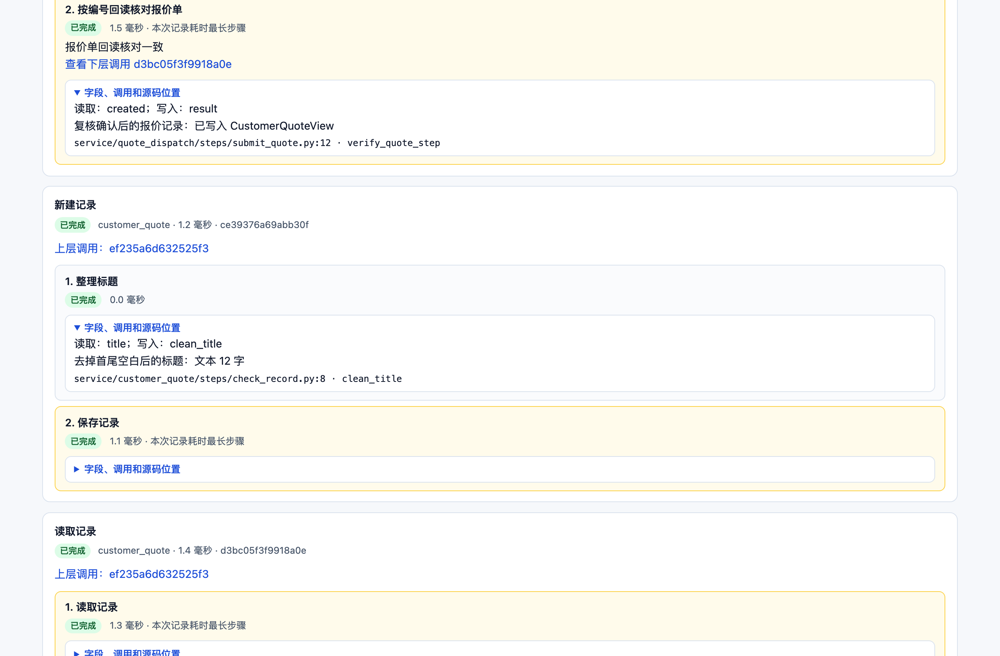
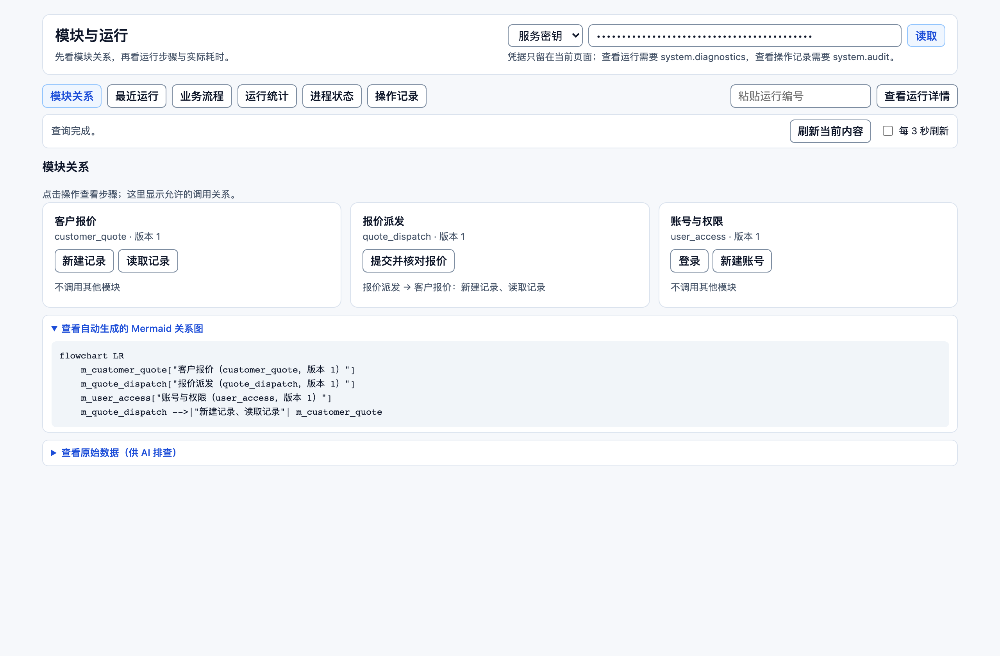
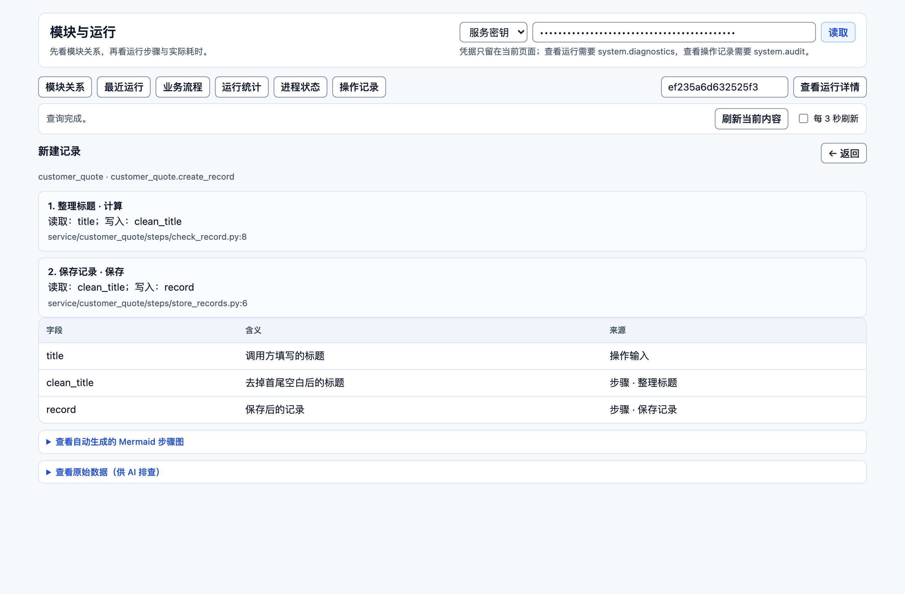
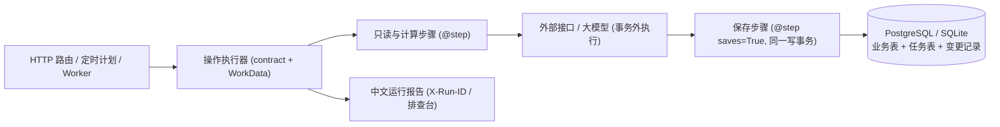

# FastAPI 模块化业务后端模板

[](CHANGELOG.md)
[](LICENSE)
[](server/pyproject.toml)
[](doc/architecture.md)
[](doc/deployment.md)
[](doc/verification.md)
[](AGENTS.md)

**简体中文** | [English](README.en.md)

这是一个面向**人类工程师与 AI 编程代理（Claude Code、Codex、Cursor、Antigravity 等）协同开发**的企业级 FastAPI 模块化单体后端模板。模板本身不预置具体行业业务：人负责审查业务规则与接口契约，AI 与开发者在固定的包边界内逐模块开发，框架统一接管步骤读写隔离、写事务边界、多租户行级校验、数据库内置队列、未知外部结果保护与全链路中文运行报告。

> **前后端全栈配套**：本仓库可单独作为任何客户端的后端底座，也可与配套前端模板 **[vue3-business-template](https://github.com/mumuxsy/vue3-business-template)** 组合使用。两端共享同一份 OpenAPI 契约、预设登录规范、`X-Run-ID` 全链路追踪编号，并内置一键启停的前后端隔离业务验收。

---

## 为什么做这个模板

传统后端脚手架只提供目录骨架和登录示例，随着业务扩张与多轮 AI 迭代，往往会迅速出现四类顽疾：

1. **跨包随意连表与互相导入**：改一张表牵动半个仓库，没人说得清一个请求到底改了哪些数据。
2. **慢速外部调用塞进数据库写事务**：在大模型或第三方 HTTP 调用期间占着数据库连接，超时重试又造成重复扣款或重复发信。
3. **线上报错只能翻海量文本日志**：请求返回 500 后，看不出停在哪个业务步骤、前面算出了什么中间值、有没有写入数据库。
4. **复制脚手架后无法升级底座**：业务代码与框架代码混改，上游修复了并发与安全问题，下游项目根本没法合并。

本模板把架构约束做成**启动校验、AST 导入检查与步骤执行器**，让违规写法在本地开发阶段直接报错，同时提供三方合并工具让下游产品随时无痛升级框架。

---

## 内置运行排查台预览

本地开发默认开启 `/system/console` 排查网页（由模板生成模块真实运行采集）：

| 最近运行与精确到源码行号的中文诊断 | 跨模块调用链路、慢步骤高亮与读写字段摘要 |
| --- | --- |
|  |  |
| **模块关系与自动生成的 Mermaid 调用图** | **流程步骤声明与 `meaning()` 字段含义溯源** |
|  |  |

---

## 核心特性

### 1. 严格分层的模块化单体（Modular Monolith）
- **三类包各司其职**：**能力包（`capability`）**独占本包数据表，跨包只允许读取已声明依赖的 `query` 操作；**流程包（`workflow`）**不建表，专门编排跨多个能力包的写操作；**纯工具包（`library`）**只放无状态纯计算。
- **AST 导入边界检查**：业务包之间只能导入对方的 `public.py`，不允许私自导入 `FastAPI`、`httpx` 或其他包的 `store` 与 `steps`；SQLAlchemy Core 查询只允许出现在 `store/`。

### 2. 声明式步骤执行器与事务安全
- **步骤级字段读写隔离**：每个 `@step` 显式声明 `reads` 与 `writes` 字段列表，未声明的字段不可读写；金额强制使用 `Decimal`，写入浮点数立即拒绝。
- **强制“先读、再调外部、最后保存”**：不带 `saves=True` 的步骤使用只读连接；进入首个 `saves=True` 步骤才开启写事务，写事务开启后严禁再调用外部 HTTP 接口或大模型，整条流程全部成功才提交。
- **字段自解释（`meaning()`）**：所有输入、输出与工作数据字段必须用 `meaning()` 写明中文用途、单位与空值含义，自动同步到 OpenAPI 文档与排查台。

### 3. 多租户存储、查询预算与字段加密
- **自动校验组织与负责人过滤**：使用 SQLAlchemy Core（无 ORM 隐式懒加载，禁止原始 SQL 字符串）。带 `org_column()` 或 `owner_column()` 的表在每层查询、子查询和更新时自动核对隔离条件，漏写直接拒绝执行。
- **单操作查询预算（`QueryBudget`）**：限制单次操作的 SQL 次数、返回行数、字节数和重复查询次数，测试环境超限立即报错回滚，从源头拦截 N+1 查询。
- **敏感数据保护**：内置 `Vault` 字段级对称加密（支持多密钥轮换），`secret=True` 字段在运行记录与日志中全程脱敏。

### 4. 免外部中间件的后台任务与多阶段流程
- **数据库原生任务队列**：基于业务同一事务提交后台任务（`later` + 业务幂等键 `key`），支持指数退避重试、并发配额（`ResourceLimit`）、同业务键串行（`SerialKey`）、执行前身份复核（`revalidate`）与定时调度（`Schedule`）。
- **大批量分段任务与多阶段 Pipeline**：支持固定范围游标分段提交（`segmented=True`）、多阶段可恢复流水线（`Pipeline` / `Stage` / `Wait`）及并行子任务扇出汇总（`FanOut`）。

### 5. 外部接口、第三方副作用与大模型接入
- **未知结果绝不盲目重发**：外部写接口（`Endpoint(..., effect="write")`）遇到超时或 5xx 时归类为“结果待确认（`UNKNOWN_RESULT`）”，停止自动重发；邮件与第三方 SDK 通过 `ProviderSpec` 先落库记录再发送。
- **版本化提示词与结构化输出**：提示词文件按版本号登记在模块的 `prompts/`，支持 `model.ask_data(...)` 按 `Data` 类型校验返回结果，本地与测试无配置时自动切换模拟回复，流式接口支持客户端断连自动取消回滚。

### 6. 全套脚手架、四层验证、TLA+ 模型与无历史三方升级
- **19 个 `uv run dev` 子命令 + 5 个内置 Agent Skill**：覆盖新产品初始化、模块/操作/流水线生成、业务词源码定位（`dev locate`）、单次操作实跑（`dev run`）、OpenAPI 导出与兼容性对比（`compare-api`）。
- **分层检查与形式化验证**：支持单包秒级快检、Git 差异影响面选包、全操作覆盖核验、PostgreSQL 17 锁与精度实测、隔离 HTTP 验收服务，以及针对多 worker 并发任务提交的 **Python + TLA+（`JobCommit.tla`）状态模型验证**。
- **安全三方框架升级（`dev upgrade`）**：下游产品无需保留模板 Git 历史，按 `template-source.json` 摘要对比旧模板、新模板与产品文件，有冲突立即中止并保持原文件不动，业务包永不覆盖。

---

## 架构与代码一目了然



在业务包中定义一个操作只需清晰的声明与步骤：

```python
class QuoteInput(Data):
    sku: str = meaning("商品编号", min_length=1, max_length=40)
    amount: Decimal = meaning("下单金额", unit="元", gt=0)


class QuoteWork(WorkData):
    sku: str = meaning("商品编号")
    amount: Decimal = meaning("下单金额", unit="元")
    total: Decimal = meaning("折后应付金额", unit="元")
    result: QuoteView = meaning("保存后的报价单")


create_quote = contract(
    "customer_quote.create_quote",
    "生成客户报价",
    input=QuoteInput,
    output=QuoteView,
    access="customer_quote.write",
    effect="command",
    errors=(QuoteInvalid,),
)


@step("计算折后应付金额", reads=["amount"], writes=["total"])
def count_total(data: QuoteWork) -> None:
    data.total = (data.amount * Decimal("0.95")).quantize(Decimal("0.01"))


@step("保存报价单", reads=["sku", "total"], writes=["result"], saves=True)
async def save_quote(data: QuoteWork, store: CustomerQuoteStore, clock: Clock) -> None:
    data.result = await store.add(data.sku, data.total, clock.now())


quote_flow = Flow("生成客户报价", work=QuoteWork, result="result", steps=[count_total, save_quote])
```

---

## 快速开始

### 环境要求
- Python `3.12` 或 `3.13`
- [uv](https://docs.astral.sh/uv/) 包管理器
- 本地开发默认使用内置 SQLite，生产环境与完整锁测试使用 PostgreSQL 17

### 1. 本地体验模板与运行排查台

```bash
cd server
uv sync --locked
test -f .env || cp .env.example .env
uv run alembic upgrade head
uv run uvicorn app.setup.web:create_app --factory --reload --no-access-log
```

服务启动后可访问：
- 健康检查：`http://127.0.0.1:8000/health/ready`
- 接口文档：`http://127.0.0.1:8000/docs`
- 运行排查台：`http://127.0.0.1:8000/system/console`（使用 `uv run dev make-key --name 本地排查 --org-id '*' --permissions '*'` 生成服务密钥填入 `.env` 的 `APP_API_KEYS` 即可登录查看）

### 2. 从模板初始化干净的新产品

```bash
cd server
uv run dev new-project /绝对路径/my-product-backend --name "订单履约系统"

cd /绝对路径/my-product-backend/server
uv sync
cp .env.example .env
```

新建的产品拥有独立的 `0.1.0` 版本号与 `template-source.json` 框架来源记录，**不会复制**本模板自身的开源 `LICENSE`、社区贡献指南、Issue 模板和展示截图，避免污染私有或商业项目。

### 3. 生成模块、实跑操作并执行检查

```bash
# 1. 一键生成与前端模板配套的账号登录包（含数据库迁移）
uv run dev new-module user_access --title 账号与权限 --preset access
uv run alembic upgrade head

# 2. 生成业务能力包并创建对应表迁移
uv run dev new-module customer_quote --title 客户报价
uv run alembic revision --autogenerate -m "add customer_quote tables"
uv run alembic upgrade head

# 3. 在命令行真实执行一次操作并核对步骤耗时报告
uv run dev run customer_quote.create_record --input '{"title": "年度维保报价单"}' --allow-write

# 4. 更新 OpenAPI 文档并运行交付级全量检查
uv run dev docs
uv run dev check --delivery
```

---

## 常用 CLI 命令与内置 Agent Skills

在 `server/` 下通过 `uv run dev <子命令>` 执行全部研发与运维动作：

| 类别 | 命令 | 说明 |
| --- | --- | --- |
| **项目与脚手架** | `uv run dev new-project <目录> --name <名称>` | 初始化干净的下游产品仓库 |
| | `uv run dev new-module <包名> --title <中文名>` | 生成能力包（加 `--kind workflow` 建流程包，加 `--preset access` 建登录包） |
| | `uv run dev new-operation <包名> <操作名> --title <中文名> --http` | 在已有包内新增操作、步骤、测试与路由 |
| | `uv run dev new-pipeline <包名> <流程名> --title <中文名>` | 生成多阶段可恢复流程骨架 |
| | `uv run dev new-library <包名> --title <中文名>` | 生成无状态纯工具包 |
| **定位与接口** | `uv run dev locate --query "<关键词或路径>"` | 按业务词、别名或接口路径检索操作与源码位置 |
| | `uv run dev inspect` | 查看已启用模块、路由、后台进程与外部依赖配置 |
| | `uv run dev docs` / `uv run dev compare-api` | 导出 `doc/api/openapi.json` 或对比版本间接口兼容性 |
| **验证与实跑** | `uv run dev run <包名.操作名> --input '{...}' --allow-write` | 真实运行一次操作并输出完整步骤诊断报告 |
| | `uv run dev check [--quick] [--module <包名>] [--delivery]` | 分层执行代码规范、类型、架构规则与测试 |
| | `uv run dev verify-model` | 验证多 worker 并发任务提交的状态模型与真实回归 |
| | `uv run dev acceptance-server --port 0 --run-id <编号>` | 启动单轮隔离 HTTP 验收服务供前端端到端联调 |
| **运维与升级** | `uv run dev make-key` / `diagnose` / `jobs` / `pipelines` / `deploy` | 生成服务密钥、诊断运行与额度、管理后台任务、部署 Compose |
| | `uv run dev upgrade --target <产品> --base <旧模板> --source <新模板>` | 三方对比预览并安全升级下游产品的框架文件 |

仓库在 `.agents/skills/` 内置 5 个随新产品一起复制的专用 Skill，AI 编程工具可按任务按需读取：

| Skill | 适用时机 |
| --- | --- |
| [fastapi-business](.agents/skills/fastapi-business/SKILL.md) | 查清产品业务规则与代码位置，或在业务完成后同步更新业务说明 |
| [fastapi-module](.agents/skills/fastapi-module/SKILL.md) | 新建或修改业务包、数据契约、步骤、SQLAlchemy 存储、任务与外部调用 |
| [fastapi-check](.agents/skills/fastapi-check/SKILL.md) | 选择最小检查范围、运行实测操作、执行隔离验收或状态模型验证 |
| [fastapi-operations](.agents/skills/fastapi-operations/SKILL.md) | 配置生产环境、Docker Compose 上线、查询运行报告与恢复多阶段流程 |
| [fastapi-template](.agents/skills/fastapi-template/SKILL.md) | 创建新产品、无共同历史三方升级框架，或分步迁移旧系统 |

---

## 文档导航

- **入门与协作入口**：[AGENTS.md](AGENTS.md)
- **模板设计原理**：[design/backend-template.md](design/backend-template.md)
- **架构与模块开发**：[doc/architecture.md](doc/architecture.md) · [框架完整参考](.agents/skills/fastapi-module/references/framework.md) · [前后端接口约定](.agents/skills/fastapi-module/references/frontend-interface.md)
- **分层验证与形式化检查**：[doc/verification.md](doc/verification.md)
- **容器部署与线上排查**：[doc/deployment.md](doc/deployment.md) · [运行详细参考](.agents/skills/fastapi-operations/references/runtime.md)
- **新产品迁移与框架升级**：[旧系统迁移](.agents/skills/fastapi-template/references/product-migration.md) · [升级框架](.agents/skills/fastapi-template/references/upgrading.md)
- **开源治理**：[参与贡献（CONTRIBUTING.md）](CONTRIBUTING.md) · [安全策略（SECURITY.md）](SECURITY.md) · [行为准则（CODE_OF_CONDUCT.md）](CODE_OF_CONDUCT.md) · [版本记录（CHANGELOG.md）](CHANGELOG.md)

---

## 开源许可

本模板仓库基于 [MIT License](LICENSE) 开源。使用 `uv run dev new-project` 创建的新产品默认不包含本模板的 `LICENSE` 文件，你可以为自己的产品自由选择专有或开源许可。
