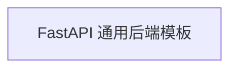

# 项目设计与结构进度

> 由 fastapi_docs.export_docs 生成。计划来自 project-plan.json；登记数量来自代码，不能表示测试通过。

主代理先读摘要：`uv run python ../.agents/skills/fastapi-project/scripts/run_project.py project --summary --json`。
单包操作与规则样例：`uv run python ../.agents/skills/fastapi-project/scripts/run_project.py project --module 模块名 --summary --json`。
单操作步骤与证据：`uv run python ../.agents/skills/fastapi-project/scripts/run_project.py project --operation 模块.操作 --json`。
修改后的调用方范围：`uv run python ../.agents/skills/fastapi-project/scripts/run_project.py impact --base origin/main --json`。
完整 JSON 仍保留供按需读取；局部检查不代替全量检查，登记和测试执行不等于业务验收。

| 业务线 | 开发包 | 已登记/计划操作 | 尚未登记 |
| --- | --- | --- | --- |
尚未填写开发包，完成比例未知。
