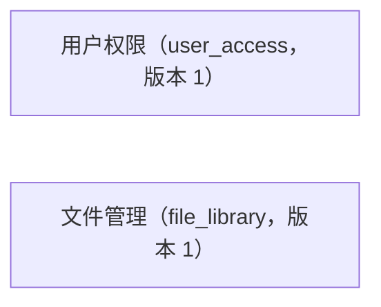

# 模块关系

> 本文件由 `uv run python -m tools.export_docs` 根据代码中的声明生成，不要手工修改；业务含义写在 各模块目录。

| 模块 | 名称 | 版本 | 业务文档 |
| --- | --- | --- | --- |
| user_access | 用户权限 | 1 | [user_access/](user_access/) |
| file_library | 文件管理 | 1 | [file_library/](file_library/) |

