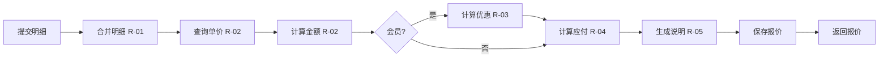

# 订单报价：规则

> 示例业务。每条规则一个编号，代码中的 `rule="R-xx"` 对应这里的标题。

## 字段

| 字段 | 含义 | 单位 |
| --- | --- | --- |
| member_level | 会员等级：none 非会员、silver 银卡、gold 金卡 | |
| lines | 报价明细：商品编码和数量 | |
| subtotal | 商品合计 | 元 |
| discount | 会员优惠 | 元 |
| total | 应付金额 | 元 |
| excluded | 没有计入报价的商品编码 | |
| explanation | 给客户看的报价说明 | |
| status | active 有效、expired 已过期 | |

## 规则

### R-01 合并明细

商品编码去掉首尾空白并转成大写；相同编码的多行合并为一行，数量相加，保持首次出现的顺序。

| 输入 | 合并后 |
| --- | --- |
| " a-1 "×2、B-2×1、A-1×1 | A-1×3、B-2×1 |

### R-02 金额与不能报价的商品

向商品目录查询单价（见商品目录 R-02）。能报价的商品：金额 = 单价 × 数量，四舍五入到分；商品合计 = 各行金额之和。不能报价的商品不计入金额，列入 excluded。全部商品都不能报价时，报价失败（错误码 `nothing_to_quote`），不保存。

| 明细 | 单价 | 结果 |
| --- | --- | --- |
| A-1×3 | 12.345 | 金额 37.04 |
| C-3×1 | 未定价 | 列入 excluded |

### R-03 会员优惠

银卡 5%，金卡 10%，非会员不计算优惠（为 0）。优惠 = 商品合计 × 比例，四舍五入到分。

| 等级 | 商品合计 | 优惠 |
| --- | --- | --- |
| silver | 10.10 | 0.51 |
| gold | 37.50 | 3.75 |
| none | 任意 | 0.00 |

### R-04 应付金额

应付金额 = 商品合计 − 会员优惠。例：37.50 − 3.75 = 33.75。

### R-05 报价说明

由大模型根据客户名称、计入的商品和数量、优惠、应付金额、未计入的编码，写一到两句中文说明，最长 500 字。提示词见 `server/service/order_quote/prompts/explain_quote.md`（版本 1）。大模型不可用时报价失败并提示稍后重试，不生成没有说明的报价。说明只用于展示，不影响任何金额。

### R-06 报价过期

创建时间早于“当前时间减指定天数”（默认 30 天）的有效报价标为 expired。重复执行结果相同。

## 流程

