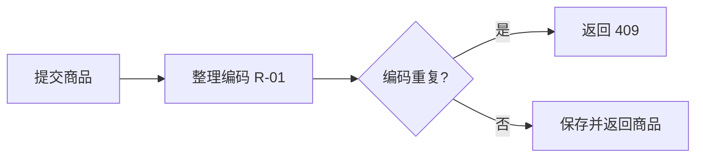

# 商品目录：规则

> 示例业务。每条规则一个编号，代码中的 `rule="R-xx"` 对应这里的标题。

## 字段

| 字段 | 含义 | 单位 | 为空表示 |
| --- | --- | --- | --- |
| code | 商品编码，全系统唯一 | | 不允许为空 |
| name | 商品名称 | | 不允许为空 |
| price | 单价，最多两位小数 | 元 | 尚未定价，不能用于报价 |
| on_sale | 是否在售 | | 默认在售 |

## 规则

### R-01 商品编码整理

保存前去掉首尾空白并转成大写；整理后的编码不能与其他商品重复，重复时返回错误码 `product_code_used`。

| 输入 | 保存为 |
| --- | --- |
| "  a-100 " | "A-100" |
| "A-100"（已存在） | 报错：商品编码已被其他商品使用 |

### R-02 可报价的单价

只有“在售”且“已定价”的商品可以报价。查询时，不存在、停售、未定价的编码都列入“不能报价”，不返回单价。

| 商品情况 | 结果 |
| --- | --- |
| A-1 在售，单价 9.90 | 返回 9.90 |
| B-2 停售，单价 3.00 | 列入不能报价 |
| C-3 在售，未定价 | 列入不能报价 |
| X-9 不存在 | 列入不能报价 |

## 流程

