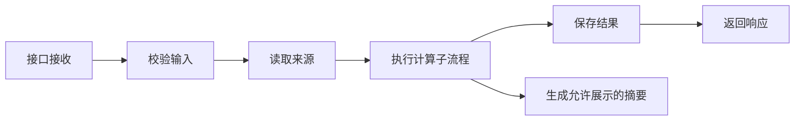

# FastAPI 通用后端模板设计

状态：第三轮实践复核稿，等待确认实施方案；尚未批准进入新一轮实现。更新日期：2026-09-23。

本文保存模板的目标、已确认决定、完整设计建议、依据和未决问题，供人类审查及后续 Agent 接手。它不表示这些能力已经实现。用户本轮明确要求继续讨论、只写文档；不修改业务代码、测试代码、依赖或部署配置。

本轮阅读顺序：先看第 2.1 节的问题与修正，再看第 17 节实施计划；新增重点为第 4.3 节统一声明、第 6 节数据使用约定及第 9.5 节外部执行恢复。今后直接更新对应章节，避免不断追加相互矛盾的讨论记录。

## 1. 项目目标与已确认决定

模板服务于中小企业的单体后端开发、既有系统逐模块迁移和 AI 辅助维护。基础框架不绑定笔记、报表或任何具体业务；案例用于证明接入方法，删除案例后基础能力仍应独立成立。

| 编号 | 已确认决定 | 对开发的约束 |
| --- | --- | --- |
| D01 | 后端使用 FastAPI，保持通用单体模板；本阶段不开发前端 | 不依赖具体业务才能启动，不拆成一套业务微服务 |
| D02 | 人类审查架构与业务，AI 按约定逐模块开发和迁移 | 优先降低阅读、检查和定位问题的成本 |
| D03 | 核心业务函数、关键步骤入图，普通辅助函数无需全部入图 | 能定位重要计算、耗时与错误，避免监控过细 |
| D04 | 不全量保存业务数据；摘要必须是人能读懂的中文 | 默认展示发生了什么、影响什么，不把原始 JSON 当阅读入口 |
| D05 | 开发环境轻量，生产能力按需要启用 | 接受分级配置；队列适用于短任务的条件仍需讲清 |
| D06 | 文件头多行说明，函数头单行说明；命名简单但职责明确 | 代码、注释、README 和业务文档均接受质量检查 |
| D07 | 本轮保存设计并继续讨论，不开发 | 不因讨论方向成立就擅自启动重构 |
| D08 | 当前需要完整设计文档以防上下文压缩后遗忘 | 取代此前“不保留架构文档”的阶段性意见；避免重复写多份总稿 |

除本表和明确标注的现状外，后续章节均是待审查的设计建议。本轮把影响实现的选择集中到第 17 节，给出推荐方案，避免开发时继续依靠推测；这些建议尚未获得用户确认。

成功的标准是：模块容易接入，非法依赖能被发现，关键字段的来源可以解释，故障可以逐层定位，修改能通过可重复检查。不能承诺任意模型、任意业务或任意部署条件下永远正确、永不宕机或永不耗尽内存。

## 2. 本次复核后修正的判断

### 2.1 本轮发现的设计缺口

本轮对一个经历多次迭代的实际项目进行了只读源码抽样，对照其历史后端和当前后端的来源处理、结果生成、外部写入及观察机制。本文件只保存通用设计结论，不引入该项目的业务实体、字段、平台规则、接口编号或生产配置。抽样包含未提交的本地代码，不能代表线上已部署状态，也不能据此归因某次生产事故。

| 缺口 | 不补清会怎样 | 本轮修正 |
| --- | --- | --- |
| 数据层偏重类型，未充分表达能否使用 | 格式正确但日期、来源范围或有效程度不符，仍可能算出错误结果 | 第 6 节增加来源、就绪判断、缺值、范围与版本约定 |
| 只管函数调用，未约束共享数据的生产和消费 | 没有直接 import，也可能通过共用表和文件形成隐蔽依赖 | 第 4.3 节登记数据提供者、消费者与真实读取入口 |
| 任务失败后重试整个处理器，缺少外部执行续接 | 再次发起已受理的外部任务，重复计算甚至重复写入 | 第 9.5 节保存提交意图、外部回执及受限恢复方式 |
| 多份声明和集中装配不断增长 | 模块、任务、图与测试各登记一次，某处漏接仍显示检查通过 | 第 4.3、14 节要求单处声明、派生索引及真实入口验收 |
| 观察只围绕异常，缺少数据质量与未触发状态 | 函数正常返回被误报成功；没有执行记录时无法区分等待与缺失 | 第 5、8、9 节分别记录执行、业务结论、数据质量和计划受理 |
| 小案例无法检验大批量读写和历史重算 | 内存、磁盘、旧结果覆盖及规则版本问题直到上线才暴露 | 第 6.5、15、17 节加入分批发布、保留历史及故障场景 |

前一轮的事务、持久任务状态、诊断保存和权限规则继续保留。此次进一步确认：分层、公开入口和大量测试本身不足以保证业务依赖清楚；这些约束必须覆盖实际数据使用与真实执行路径。所有新增规则仍待实现验证。

### 2.2 持续保留的判断限制

| 先前容易产生的理解 | 修正后的设计判断 |
| --- | --- |
| 没有长任务就不需要队列 | 短任务也可能需要隔离、错峰、重试和可靠交付；按执行语义选择 |
| 队列轻量，所有请求走队列影响不大 | 消息发送、序列化、确认、等待和结果获取都有成本，需测量 |
| 把调用记录画成图就能解释计算过程 | 模块关系、流程定义、实际执行和字段来源是四种不同信息 |
| 全部经过监控就能看到任意计算细节 | 未声明的字段含义及内部算法无法由包装器可靠推断 |
| 找到失败函数就能立刻修好 | 还需要实际输入条件、规则版本和预期样例；错误结果可能根本不抛异常 |
| 图和文档都自动生成就不会不一致 | 代码图能自动生成；业务含义仍需人确认并用样例检查 |
| 超时代表工作停止，失败代表没有写入 | 外部操作可能已完成；同步线程可能仍在运行，需保留未知状态 |
| 注册、测试能禁止 AI 乱改一切 | 能约束正常开发；无法防止拥有写权限者同时删除检查及限制 |
| 行数合格、注释齐全就易读 | 只能检查部分形式，仍需检查职责分组和说明是否准确 |

最需要防止的是把通用模板继续发展成一个自制的庞大工作流平台。第一版只处理已明确需要的模块连接、步骤执行、数据检查和观察；复用任务队列、数据库驱动和安全库，不自建通用日志检索平台。少量业务运行记录属于模板自身数据，按第 8.4 节限定范围。

## 3. 总体分层与依赖

### 3.1 建议目录

当前实际代码仍在 `code/server/`。下列根目录布局是目标建议，本轮不移动、重命名或删除现有文件。目录采用小写下划线；`AGENTS.md`、`README.md` 等标准文件名保留。

```text
项目/
├── AGENTS.md           项目规则、阅读顺序、修改范围和检查命令
├── README.md           人类阅读与运行入口
├── server/
│   ├── app/            API、启动组装和模块总目录
│   ├── service/        按业务功能组织的模块
│   ├── shared/         通用约定、执行机制和基础能力
│   ├── tests/          功能、架构、质量、恢复等检查
│   └── deploy/         环境、启动、容器和运维检查
└── doc/
    ├── README.md       业务目录和阅读入口
    └── 业务名称/       需求、规则、样例与业务变化
```

本项目正在制作模板，因此当前 `docs/` 保存这份模板设计。未来使用模板开发具体产品时，产品的 `doc/` 主要保存真实业务；不要复制本次聊天或把技术宣传混入需求。推荐本轮后续实现继续使用 `code/server/` 与 `docs/`，待可运行模板验收后再处理交付目录，避免同时改变路径和执行机制。

### 3.2 各层职责

| 层 | 负责 | 不负责 |
| --- | --- | --- |
| app/api | HTTP 输入、身份与权限接入、响应、错误、文档和运行查询接口 | SQL、业务计算、任意查找内部模块 |
| app/setup | 配置校验、汇总模块声明、选择实现、初始化和关闭资源 | 长期保存请求数据、编写业务规则 |
| service | 业务输入输出、公开操作、流程、计算步骤及数据访问约定 | 自建日志体系、连接池、队列或全局注册表 |
| shared/data | 类型与字段说明规范、序列化、分页及通用数据约定 | 定义全项目的所有业务实体 |
| shared/modules、flow | 注册检查、受限调用、流程执行和统一观察接入 | 任意插件热加载、业务权限推断 |
| shared/monitor | 中文摘要、调用关联、实时状态及历史记录导出 | 自动解释任意算法、默认保存全部正文 |
| shared/db、jobs 等 | 连接、事务工具、迁移接入、任务投递和基础资源管理 | 替业务决定重试、补偿或数据归属 |
| tests、deploy | 验证约定、运行资源和发布检查 | 用测试通过替代业务确认 |

公共能力只按已实现且用途明确的功能建立；避免堆积空目录。缓存、文件、通知等采用同样的公开约定和实现分离方式，在有适用场景时增加，不默认安装所有中间件。

业务计算依赖明确的操作约定；数据库或平台实现遵守约定；启动层负责连接。存储实现引用业务声明的接口可以符合依赖倒置，业务直接创建具体数据库连接会增加耦合。业务步骤不接收能访问全系统的万能注册表。

导入规则按职责执行：API 只使用公开数据与操作；计算步骤不导入 FastAPI、ORM 或队列实现；资源实现可以导入它所实现的业务约定；启动层可以汇总这些实现。`shared` 的通用执行代码不得导入某个具体业务。文件所在目录不能代替对实际依赖方向的检查。

## 4. 模块组织、注册与插件方式

### 4.1 一个模块的结构

```text
service/业务名称/
├── README.md           职责、入口、依赖、内部组织和业务文档位置
├── module.py           模块声明与组装入口
├── public.py           其他模块可使用的操作约定
├── data.py             明确的输入输出及字段含义
├── flow.py             步骤连接、分支和子流程
├── steps/              核心计算；相近功能集中组织
└── store/              数据源和保存实现，按需要存在
```

模块按可说明的业务能力划分。页面中的大表格可以作为识别边界的线索，但不能把页面边界强制等同于事务、权限或业务所有权。简单模块可以只有一个步骤；复杂模块按可独立理解的子流程展开，不机械套文件数量。

角色和页面可以组织阅读入口，但共用业务能力必须有单一所有者，不能按角色复制同一算法或互相读取私有表。面向页面的模块只组合所需能力；多个页面共用的能力仍按业务含义命名，不因此搬入包含大量行业规则的 shared 包。

Cowan 的研究讨论了特定条件下工作记忆的信息块限制，不能直接推导出文件行数或目录数量上限。本设计从中采用“少量职责分组、逐层展开”的阅读原则，具体阈值属于工程试用值。[研究原文摘要](https://pubmed.ncbi.nlm.nih.gov/11515286/)。

### 4.2 两级注册

全局登记启用的模块及其实现选择；每个模块声明名称、中文用途、版本、公开操作、输入输出、允许依赖、流程、错误与业务文档。全局汇总可供查询，但不把全部内部步骤复制到一个巨大文件。

测试检查发现业务包却未登记；启动检查登记重复、依赖缺失、公开操作不存在和连接不兼容。明确关闭的模块不加载；其他模块若依赖它则启动失败，禁止静默跳过。声明读取应避免连接数据库和启动任务等副作用。

注册后给调用方注入只包含所需操作的入口。运行时检查调用身份和操作范围；不通过动态字符串随意取得任意服务。登记后的路由和任务入口也必须绑定模块，避免在接口层另写一条不受管理的业务路径。

依赖声明细化到公开操作，不能登记一个模块名就获得其所有操作。入口包装器统一处理类型、调用身份和观察；调用方不能通过请求字段自行指定内部模块身份。业务源码只允许导入其他模块的公开约定，禁止导入其步骤、存储或私有实现。

同进程模块调用保持本地调用，无需 HTTP 或消息队列。插件首先表示“在启动时选择、校验并注入实现”；首版不支持导入未知代码、运行中随意换实现或自动扫描后全部启用。

正常依赖形成可检查的方向；同步循环依赖应拒绝。互相协作优先交给上层流程安排；通过消息协作时仍要声明发送和接收关系，限制重复传播，不能借消息无限循环。初始化按依赖顺序，关闭按相反顺序，避免资源未就绪就接收请求。

Spring Modulith 提供模块公开入口、显式依赖和循环检查等成熟参考。本模板借鉴其约束方式，不照搬 Java 的目录和运行机制。[官方模块检查](https://docs.spring.io/spring-modulith/reference/verification.html)。

### 4.3 一份声明连接操作、数据、任务与观察

每个模块的 `module.py` 返回明确的模块声明，引用本模块公开操作、流程、提供的数据、消费要求及可选任务。全局目录只登记启用哪个模块，不再手工复制一遍它的任务、字段或监控清单；API 文档、关系图和测试清单从同一声明生成或核对。

数据提供声明至少包含所有者、稳定名称、格式版本和读取操作；消费声明包含用途、所需字段、适用范围和就绪规则。跨模块读取通过提供者的公开操作或受限只读接口；同一数据库不表示可以任意读写其他模块的私有表。写入归唯一所有者，跨表聚合读面需单独声明来源和版本。

依赖关系包含代码调用与数据消费两种方向。来源变更时应能反查受影响的输出、消费者和测试；只有数据表名或模块名而没有使用约定，不算完整登记。权限、租户范围和实际采用的来源引用仍在运行时核对，静态图不能代替这些检查。

声明函数无 IO、无导入时自动登记；启动创建独立注册实例，完成校验后固定。API 与 worker 使用同一已发布清单并比较定义摘要。生产启用的依赖不允许一直处于“以后会实现”的等待状态；未完成能力应明确关闭并拒绝入口，不能由测试偷偷补齐接线。

新增普通模块应主要修改自身与总目录。连接多个业务能力的流程归某个业务编排模块，启动层只负责连接实现；不能把业务分支、来源特例和重试规则塞进中央运行循环。框架读取声明及策略，不根据某个业务名称执行特判。

## 5. 计算图与执行规则

### 5.1 四种视图共用稳定编号

| 视图 | 来源 | 用途 |
| --- | --- | --- |
| 模块关系图 | 注册声明 | 看允许的依赖，不冒充实际调用 |
| 计算流程图 | 可执行流程定义 | 看顺序、分支、子流程和输入输出 |
| 实际执行图 | 某次运行记录 | 看走过、跳过、失败和等待的步骤 |
| 字段来源图 | 字段映射、规则声明和运行关联 | 看输出依赖哪些输入及计算规则 |



图是业务步骤的观察与执行方式，不要求每个辅助函数入图。核心步骤必须可以定位到源码符号、代码版本和相关规则；算法内部确有排查价值时再增加子步骤。摘要生成失败通常不改变业务结果，示意图中的摘要分支不表示必须等待远程监控写入。

### 5.2 首版执行范围

建议使用带类型的 Python 定义流程，由同一份定义生成 Mermaid 和 JSON；不要另外维护一套 YAML 执行语言。流程编排只连接注册步骤，步骤内部保留普通 Python。纯计算与读写资源的步骤应能区别识别。

首版建议支持顺序、显式条件分支和子流程。大数据步骤可以使用有容量限制的分批读取，记录批次数和失败位置；首版不提供图级并行、循环或逐条数据展开。并发请求及多个 worker 仍可执行各自的流程。长期等待人工输入、跨重启从任意步骤恢复等能力不在首版范围。

步骤声明输入输出类型、中文动作、允许的外部操作、相关规则及必要的执行限制；区分纯计算、读取、本地写入和外部写入。连接检查采用可实现的明确规则；复杂类型转换要求显式转换步骤，不承诺推导所有 Python 类型关系。

启动时校验步骤编号唯一、输入有来源、目标操作存在、分支结果兼容、无不可达步骤或循环引用，随后固定流程定义。可选值不能直接连到必填字段；常量、默认值和转换必须显式声明。运行时按实际分支记录执行，不为未走过的分支制造结果；普通辅助函数内部不再假装可见。

执行状态、业务结论和数据质量分别记录。节点正常返回可能意味着等待来源、拒绝执行或产生部分结果，执行器必须读取声明的结果约定，不能仅靠是否抛异常判断成功。一个节点一次尝试只有一个明确终态；保护性拒绝不应同时留下“失败”和“成功”两条矛盾记录。

输入输出默认避免被其他步骤隐式修改；不要靠复制整份大数据来实现隔离。大对象传递受权限控制的引用，分批读取，并声明哪些资源由谁释放。禁止在全局可变字典中积累整次流程的所有数据。

执行器管理上下文、状态、校验和观察。事务由明确的业务操作安排，不自动在每个步骤提交；并行步骤不共享同一个数据库会话，外部请求不放进长时间持有数据库锁的事务。

调用上下文只携带已验证身份、请求关联和执行期限等控制信息，不兼作业务变量仓库。嵌套操作沿用剩余时间与取消请求，不能每进入一层就重新获得完整超时时间；限制子流程深度和单次核心节点数量，避免有界步骤拼成无界执行。

异步等待、同步阻塞调用和 CPU 密集计算需区分执行位置。超时不一定能终止线程或撤销外部动作；取消后应记录实际已知状态，不默认重试。进程隔离适用于需要独立资源限制的重计算。

### 5.3 事务与失败后的真实结果

事务范围在业务流程中声明，由最外层持有该范围的操作负责开始、提交和回滚。事务应覆盖需要共同成功的短小读写，不默认包住整次 HTTP 请求。子模块的存储实现参与已有事务，禁止内部自行提交；独立调用时由其外层入口建立自己的范围。

同一数据库内需要原子更新的多个模块，可以通过启动层注入的事务作用域共享一次提交。各模块只看自己的数据访问约定；数据库会话留在资源实现内部，不进入业务数据或公开参数。该范围内顺序执行，不跨线程或并行任务共享会话。[SQLAlchemy 会话与事务说明](https://docs.sqlalchemy.org/en/20/orm/session_basics.html)。

业务不变量、公开输出及其约定的可序列化性在提交前检查；提交成功后再报告成功。API 专属的版本转换通过约定测试检查，不让业务层依赖 HTTP 模型。提交后转换或发送响应失败、客户端断开及监控失败，都不能改称数据库已回滚。提交结果因连接中断无法确认时，返回可关联的操作编号，并按幂等记录或实际数据核对。

并发更新通过数据库约束、版本检查或业务需要的锁处理；仅在 Python 中先检查再写入不构成并发保证。涉及多次独立提交的流程应记录已完成部分，不能以最末步骤失败覆盖前面的持久结果。

外部 HTTP、消息发送及不同数据库不加入同一个本地事务。可靠发消息使用第 9 节的待发送记录；外部写入需声明幂等、查询结果或人工核对办法。通用框架不自动猜测补偿动作，也不承诺跨系统同时成功或同时撤销。

## 6. 数据约定、字段说明与存储分离

### 6.1 类型、含义与存储约定

通用数据层提供定义规范和工具，业务模块拥有具体数据类型。禁止用万能字典取代所有类型，也不要求所有数据强行继承包含 id、创建时间等无关字段的实体基类。

字段至少说明中文含义、类型、是否必填和空值含义；适用时增加单位、精度、合法范围、示例、安全分类和规则编号。禁止将“没有值”“计算失败”和数字零自动视为同一种状态。

金额及精确数量须明确十进制精度和舍入规则，时间须说明时区与业务含义；模板不替业务猜测这些规则。边界转换必须明确是否允许字符串转数字等行为，避免依赖库默认转换悄悄接受错误数据。

Pydantic 可负责边界校验和 JSON Schema 导出，字段说明及扩展属性承载机器可读的约定。纯算法是否采用 dataclass 或其他明确类型，可按需要选择，不要求反复转换和重复校验每个局部变量。[Pydantic 字段及 Schema 支持](https://docs.pydantic.dev/latest/concepts/json_schema/)。

字段的业务含义由人确认；字段来源在流程连接处声明；计算规则在对应步骤及业务文档中解释。复杂算法不复制成第二份“公式实现”，避免两份逻辑失配。通过明确样例及不变量检查说明与实现是否一致。

API 数据、模块间数据和数据库内部对象按职责区分。可以复用稳定约定，但 ORM 对象和数据库会话不得跨模块随意传递。外部平台格式由来源实现转换成模块接受的数据，来源变化不应迫使计算步骤理解平台细节。

数据源工厂只在启动组装处选择实现。框架提供连接和事务管理能力，业务拥有查询语义与数据访问约定。SQL、表结构和迁移归属要清楚；更换数据库必须通过真实实现和迁移检查，不能仅改连接地址就宣称可替换。

JSON Schema、字段表、接口模型和字段映射文档从相应定义导出。导出物标明生成来源与版本；修改生成结果不能替代修改定义。运行编号、身份及诊断上下文单独管理，不要求每个业务对象携带整套追踪信息。

传入任务的大对象引用必须有访问范围、校验信息及有效期，保存时间至少覆盖该任务允许的等待与重试时间。诊断记录过期可以失去排查细节，业务输入提前过期则可能导致任务无法执行，两者不能共用未经区分的清理规则。

### 6.2 数据已收到与业务可以使用分别判断

对于跨来源计算、批量导入和派生结果，提供者记录来源版本、处理结果、数量与质量事实；消费方声明自己能接受的日期、范围、新鲜程度和缺失情况。同一份数据可能足够支持一种功能，却不足以支持另一种功能，框架不得用一个全局 ready 替所有业务决定。

就绪判断采用纯函数：传入消费要求、来源事实和明确的判断时点，返回可用、需等待、可按规则降级或不可用及原因。不在判断函数中读数据库、调用平台或自行取当前时间；读取与安排后续工作由流程负责。可等待状态也必须有截止条件，不能无限重试。

值状态区分真实值（包括零）、缺失、不适用和无法计算；数据质量另说明完整、部分、过期或尚未确认。具体显示词由模块提供，不能把所有状态压成 `None`、数字零或一段自由文本。普通 CRUD 字段无需一律包上这些信息；对计算和诊断有意义的输入输出按约定使用。

覆盖比例只有在期望范围明确时才成立。来源里观测到了多少对象，不等于业务应该有多少对象；无法确认分母时明确说明范围未知，不能显示虚假的全量覆盖。人工输入和配置同样可作为来源，记录其确认人与版本，不强行当作外部采集数据。

### 6.3 来源身份、时间与一次计算采用的版本

来源引用按需要保存来源命名空间、业务身份、有效日期或区间、实际取得时间、输入批次、格式版本及内容摘要。业务时间与采集时间分开，不用服务器当天日期代替业务日，也不从现有数据反推“应该使用哪一期”。

同名对象不能直接合并；身份转换必须引用明确的映射及其有效版本。无法唯一匹配时保留冲突说明，由业务决定是否停止或部分处理；框架不按名称相似度替人做业务判断。

一次计算先确定实际采用的来源批次、规则版本、必要的身份映射及范围快照，再按这些引用读取。执行到不同步骤时不能各自取一次“最新”。可变来源需要一致性快照或前后版本检查；只固定一个批次编号而底层内容仍可随意更新，不构成可靠冻结。

输出保存实际采用的引用，历史诊断读取当时定义与输入版本。重新计算产生新结果版本，并关联旧版本及原因；旧事实、已发布结果和当时的业务解释不因今天的代码变化而自动改写。下游展示或导出也应说明当前采用哪个结果版本。

### 6.4 处理异常行的规则必须显式

入口协议、形状校验、单位与身份转换、业务质量判断分开组织。外部请求成功但文件缺列、产物尚未生成或返回形状不符，应在相应阶段说明，不能转换成正常空列表。外部适配器把错误转成稳定分类，业务不通过异常中文字符串判断是否重试。

逐行无效、重复、过滤及真正空集分别计数；是否允许保留好行由业务策略声明，不统一规定部分无效就整批失败，也不静默丢弃坏行后报告全部成功。每个阶段的计数分类互斥；一行可以有多个原因，但原因数量不能直接相加冒充剔除行数。

一进一出的筛选步骤核对输入、保留、排除和拒绝数量；聚合、连接或一行拆多行时声明自己的数量关系与业务不变量，不能套用行数相等。诊断默认保留统计与受控定位引用，无需把全部原始行写入日志。

### 6.5 分批处理、结果发布与文件生命周期

大数据处理约定读取批量、稳定排序键、并发上限和内存预算。全局聚合通过数据库或有预算的外部计算完成，不能分批读取后又把全部批次积累进列表。图保持少量核心步骤，批次进度使用聚合统计和少量失败定位，不为每行建立常驻节点。

需要较长时间生成的结果采用草稿批次或临时产物，分批处理后校验完整性，再用短事务发布可见版本。失败的草稿不能覆盖已有正式版本；读取端要区分“旧版本仍可用”与“本次更新失败”。是否允许继续使用旧数据、允许多旧，由消费规则决定。

数据库与文件存储不能共同回滚。先保存带完整性校验的不可变文件，再提交指向它的结果记录；失败留下的孤立文件按受限任务清理，禁止删除仍被正式版本引用的文件。需要完整交付的导出在准备完成后才开放下载，直接流式接口则明确其中断语义。

资源预算同时包括内存、临时磁盘、数据库连接、长事务时间及保存期限。取消、下载断开和异常都关闭游标、文件与连接；重启后的孤立临时数据由清理任务处理。分批策略是可选基础能力，不强迫普通小事务采用整套批次模型。

## 7. 人能读懂的运行摘要

默认入口先给简短中文说明，再按需展开图、字段、步骤和原始记录。同一份底层事实支持人类摘要和 Agent 查询；保留结构化存储便于检索，阅读页面不强迫人处理结构化日志。

摘要由经过校验的固定模板和模块提供的中文名称生成，不默认调用大模型。只解释已观察到的事实；疑点、直接失败原因和经过验证的业务原因分开表达。未知就写未知，不把异常类型自动扩写成猜测。

以下仅是拟议展示样例，数字和业务名称均为虚构，不是当前系统运行结果：

> 这次导入在“检查价格”步骤停止：有 3 条记录没有提供单价，后续金额计算和保存尚未执行。缺失字段来自“读取来源”步骤。可以展开查看对应字段说明、规则和源码。本次记录完整，原始内容未保存。

只有执行状态能够证明后续未开始时，才允许这样描述。发生外部写入或事务状态不明时，应显示“保存结果尚不能确认，请核对”，不能为了摘要顺畅而说“没有影响”。

首屏说明业务动作、当前结果、已知影响和下一步查看入口；具体异常堆栈、字段路径、运行编号及版本放在可展开部分。摘要长度限制按阅读体验试用，避免为少字省略条件。

数据质量问题也使用中文摘要，例如“本次计算已完成，但部分输入缺失，相关结果暂未计算；页面仍展示上次已发布版本”。这类说明必须引用实际字段状态和发布记录，不能把服务运行正常改写成数据完整，也不能把等待来源当作程序崩溃。

敏感字段默认不进入摘要；中文字段名本身也可能敏感，需按权限过滤。摘要、Mermaid 图和导出内容统一进行输出转义，不把输入中的文本直接当成 HTML 或图语言执行。

## 8. 监控、字段观察和诊断查询

### 8.1 记录范围

| 内容 | 默认处理 |
| --- | --- |
| 请求与步骤编号、名称、状态、版本、耗时 | 采集必要记录，并限定容量和保留策略 |
| 字段类型、缺失情况、处理数量 | 使用允许的安全摘要，限制规模 |
| 字段原值、中间结果 | 默认不保存，按允许名单、权限和诊断范围开启 |
| 大文件、图片和大型列表 | 不复制进调用记录，记录受控引用或统计 |
| 密钥、令牌及不可记录内容 | 禁止进入诊断记录 |
| 运行日志、性能指标、业务审计 | 按各自目的管理，不能混成一种保存策略 |

观察分两部分：OpenTelemetry 等成熟工具负责调用、日志和指标的采集导出；模板补充业务名称、规则关联、字段来源和中文诊断。字段来源可参考 OpenLineage 的输入与输出字段关系，但首版不因此引入整个数据治理平台。[字段来源规范](https://openlineage.io/docs/spec/facets/dataset-facets/lineage/)。

### 8.2 实时与历史

常规批量调用追踪主要围绕结束的 span 导出，不能单靠它表达实时运行状态。模板应另行定义开始、进度和结束状态的查询机制；首版可用查询，持续订阅后续按需要增加。[OpenTelemetry SDK](https://opentelemetry.io/docs/specs/otel/trace/sdk/)。

请求、任务、流程、步骤、重试次数、上级步骤及数据格式使用可关联编号。跨线程或队列传递上下文；并行分支、重试和消息触发关系不能假装成一条简单函数调用栈。代码版本应对应实际部署版本，源码行号只作辅助。

进程重启、监控故障或状态过期时显示“未知”或“失去联系”。历史记录、活动状态和任务最终结果可以有不同存储，但必须有明确权威来源及一致性说明，不能互相覆盖成假成功。

排查没有生成结果的情况，需要同时查看应执行计划、持久受理记录和实际观察。只有计划及可靠执行记录能证明时，才说明“未受理”或“未执行”；仅缺少采样记录时说明“没有足够记录”。字段定位沿实际采用的来源版本展开，当前来源已经恢复不代表旧结果当时使用的数据正确。

端到端等待、排队、数据库或网络等待、步骤持续时间分别表达；嵌套时间不能相加当总耗时，并行时间不能直接相减当自身 CPU 时间。CPU、内存剖析按需接入，不常态开启逐行跟踪。

### 8.3 资源和权限

采集、传输和查询均有界：限制单条大小、缓存数量、字段数量、批量大小、查询页数及保存期限。成功路径可按规则采样；错误记录优先保留但不承诺永不丢失。采样、截断、丢失和已过期必须显式标注。

日志采用结构化安全字段并配置输出轮转或平台保存限额；不默认记录请求正文。指标标签仅使用受控的模块、操作和状态，运行编号、用户编号及原始 URL 等高变化内容留在记录中，避免指标组合无限增长。采样未保留的成功过程发生后续错误时，只展示现有事实。

普通观察故障通常不使业务失败；必须留存的业务审计采用单独可靠机制及失败策略。字段值未提前采集时，故障后不能凭空恢复；不能未经授权重放有外部写入的业务来补日志。

生产诊断入口只读、默认不公开，检查身份、业务范围和数据权限，并记录查询行为。Agent 按运行编号先取摘要，再查询必要节点；设置条目与响应大小限制，禁止默认导出全库日志或拥有任意执行代码能力。

多进程记录需要集中查询，不能随机命中一个进程内存就声称看到了全局。保存方案见第 8.4 节，实际保留期限及访问角色在部署时确认。采集工具无法自动判断数据是否敏感，仍需业务分类。[敏感数据处理](https://opentelemetry.io/docs/security/handling-sensitive-data/)。

Collector 的缓存和重试能减少丢失，但仍可能因缓存满、超时或存储故障丢记录。应限制自身资源并监测丢失，不能无限等待或占满内存。[Collector 故障处理](https://opentelemetry.io/docs/collector/resiliency/)。

### 8.4 保存什么、查询什么、相信什么

OpenTelemetry Collector 负责接收、处理和导出遥测数据，本身不能代替历史查询数据库。仅配置 Collector 不算完成本模板的运行查询能力。[Collector 官方职责](https://opentelemetry.io/docs/collector/)。

| 信息 | 建议的首版保存方式 | 查询时的含义 |
| --- | --- | --- |
| 已发布的模块、流程和字段定义 | 按发布版本保存不可覆盖的定义文件与摘要编号 | 解释当时的流程，不能用最新版覆盖旧运行 |
| 业务事实、任务受理及最终结果 | 业务数据库中的相应记录 | 不采样；按事务及业务恢复规则确定结果 |
| 中文摘要所需事实、核心节点状态和关联 | 本地可用有界内存；生产用 PostgreSQL 中独立管理的诊断表 | 允许延迟、采样或缺失，不能覆盖业务事实 |
| 技术调用追踪、日志和性能指标 | 标准导出接口连接部署方选定的保存服务 | 用于深入定位；未配置保存服务就明确不提供该类历史 |

诊断表仅保存受限的运行与核心节点事实、版本、允许的统计及字段来源引用，不复制全量 span、原始日志和请求正文。首版只实现按运行编号、时间、模块和状态等固定条件分页查询；不自建通用搜索语言或监控平台。

诊断写入采用有界缓冲与批量提交，使用单独的连接限额和清理策略；业务线程不等待远程观察服务。共用一台数据库仍有 CPU、磁盘和连接竞争，需验证资源预算，压力增加时允许将诊断库分开部署。

实时状态说明最后更新时间；超过约定时限显示“失去联系”，任务结果另查持久记录。采样决定、步骤完成情况和丢失统计共同描述完整性；没有结束记录的运行一律不能声称记录完整。进程突然退出可能连丢失计数都无法保存，不能报告虚假的零丢失。

任务结果由第 9.4 节确定；同步调用则按事务结果和实际响应状态描述。客户端是否收到响应不由服务端单方面保证。普通监控允许缺失；必须可靠保存的业务审计应与业务事务或可靠待办一起提交，禁止伪装成永不丢失的诊断日志。

诊断查询复用资源权限检查，只返回允许的字段与安全源码位置，不返回源码全文、磁盘绝对路径或服务器凭据。首版提供只读 API 和中文 Markdown 导出，不开发前端；历史定义的保留至少覆盖引用它的任务和诊断记录，所有查询实例都能按版本取得相同定义，不能仅保存于已经退出的旧容器。

## 9. 队列适用条件与成本

### 9.1 没有长任务也可以使用

选择队列主要看是否需要延后完成、隔离故障、承接突发量或可靠重试。任务长短只是因素之一。

| 场景 | 建议处理 | 需要承担的变化 |
| --- | --- | --- |
| 返回前必须取得结果的普通查询 | 本进程直接调用注册流程 | 保持清楚的同步响应 |
| 短小通知、允许稍后更新的索引 | 可进入队列 | 允许短暂延迟，处理重复和失败 |
| 大量短小任务突然到达 | 可进入有界队列，并考虑批量 | 观察等待时间、队列容量和消费者能力 |
| 高资源计算或需要重试的外部调用 | 独立 worker，按任务语义入队 | 资源限制、状态查询及失败恢复 |
| 一个流程中的每个小函数 | 不默认分别入队 | 避免传输和调度开销超过计算 |
| 同步请求入队后立即等待结果 | 不作为通用默认方式 | 增加等待和故障环节，仍未解除同步依赖 |

“部署队列服务”“让某项业务入队”“让全部 API 入队”是三个不同决定。部署但少量使用仍会有进程、连接、内存和运维成本；是否可以接受由实际环境决定。不能未经测量保证性能影响很小。

消息路径增加序列化、传输、确认、调度和可能的持久化成本。队列可能提高突发流量下的处理稳定性或总体吞吐，也可能增加单次完成延迟；返回 202 更快不表示业务更快完成。

Celery 官方建议根据长短任务分别配置和路由消费者，并说明无限预取可能导致内存问题。这支持短任务使用队列，但不支持“统一默认配置就足够轻量”的结论。[Celery 优化说明](https://docs.celeryq.dev/en/stable/userguide/optimizing.html)。

### 9.2 可靠执行约定

首个外部队列实现建议采用 Celery + RabbitMQ，作为可选运行配置；待第 17 节方案确认后实施并锁定经测试的版本。封装任务登记、发送和状态约定，但不抹平不同实现的投递语义。开发测试可有直接执行实现，必须明确它不能验证真实消息确认、重投或进程故障。

消费者按至少可能重复执行设计。声明允许重试的错误、次数、间隔和幂等条件；发送通知、扣款、提交订单等外部动作不能由通用 AOP 自动重试。任务过期、失败和人工重试分别记录，保留原任务与新尝试关系。

可靠任务统一采用事务发件箱：任务及待发送记录在同一数据库事务保存；若受理任务同时修改业务数据，这些修改也加入该事务，再由后台发送。发送仍可能重复，需要消费者去重或业务幂等；不宣称分布式操作天然只执行一次。[事务发件箱参考](https://docs.aws.amazon.com/prescriptive-guidance/latest/cloud-design-patterns/transactional-outbox.html)。

只有任务与待发送记录已经提交，才返回“任务已受理”、任务编号及查询地址；无需等待业务执行完成。消息投递确认只说明发送阶段的结果，不等于业务成功。数据库未可靠保存时明确失败或结果待核对，不悄悄转成同步执行。

同一实体相关任务若依赖顺序，应声明并使用相应限制；多个消费者、重试和优先级会影响观察到的顺序。业务更新还需要版本冲突检查，不能只依赖队列顺序解决并发。

### 9.3 容量与观察

生产者长期快于消费者时，队列会持续积压；限制入口速率、待办数量、消息大小、预取和消费者并发，并明确满载时拒绝、延期或按已确认规则合并的行为。只记录队列长度不足以保护整个系统，消费者已取走但未完成的任务也占资源。

待发送表同样计入容量，不能让 broker 的容量限制变成数据库无限积压。首版可靠任务在受理前检查数量与字节预算，满载明确拒绝新任务；多个 API 实例必须使用可保证并发一致性的受理计数，不能各自读一个旧数值后继续放行。已经受理的任务不得为腾空间而静默删除。

RabbitMQ 的队列长度限制不包含未确认消息；默认达到上限的处理可能删除队头消息，因此可靠任务必须显式审查溢出策略，不能只填一个容量数字。[队列长度与溢出策略](https://www.rabbitmq.com/docs/maxlength)。

观察任务到达量、完成量、最久等待、执行耗时、失败重试、积压字节和进程资源。短任务批量处理可降低发送开销，但需保留批次内失败的定位和重复处理约定。调参用实测，不在文档编造并发或延迟保证。

### 9.4 任务状态、重复执行与取消

模板自己的持久任务记录负责对外状态，Celery 状态和调用追踪仅作为辅助。任务编号代表一项已受理工作，每次执行另有尝试编号；消息编号、重投次数不能冒充新的业务任务。任务记录关联输入格式、流程及规则版本，生产消息只接受明确允许的序列化格式。

消息只携带任务引用和最小追踪信息，执行参数及授权依据从受控的任务记录取得；不可将消息中自报的用户身份直接当作授权。broker 限制生产者、消费者的访问范围，采用允许名单中的 JSON 格式，不接收可反序列化任意 Python 对象的输入。持久任务输入是执行所需业务数据，按业务保存与访问规则管理，不能套用诊断采样策略。

| 状态 | 能确认的事实 | 后续约定 |
| --- | --- | --- |
| 已受理／等待执行 | 任务和待发送记录已持久保存 | 后台投递，等待可用消费者 |
| 执行中 | 某次尝试已取得执行权并更新活动时间 | 活动信息过期时进入核对，不直接宣布失败 |
| 等待来源／外部结果 | 已知依赖尚未满足，或外部已经受理但未完成 | 保存条件与下一次检查时间，不重新提交外部工作 |
| 等待重试 | 已知错误符合声明的重试条件 | 按次数、间隔和总时限安排下一次尝试 |
| 成功 | 约定的业务结果和任务结果已经可靠保存 | 不因监控丢失或消息重投重新产生业务效果 |
| 失败／过期／已取消 | 已确认停止或不会再执行，保留已完成影响 | 不能用这一状态暗示所有历史写入均已撤销 |
| 结果待核对 | 外部结果或提交情况不能确认 | 自动查询或人工核对；不盲目重新写入 |

取消请求单独记录，只有确认尚未开始或已在安全位置停止才标记已取消；正在执行的外部写入不能凭一条取消指令判定已撤销。重启后通过持久记录恢复待办；首版可重新进入整个登记任务，由外部操作适配器依据持久回执续接，不从任意 Python 步骤自动恢复执行位置。

幂等表示重复请求不会多产生一次业务效果。键表达调用方的一次请求意图，作用域包含调用身份或业务范围及稳定的公开操作；首次受理时冻结参数、规则版本和来源引用。同键同参数返回原任务或结果，同键改变语义参数明确冲突，不能因当前部署或规则升级自动产生新任务。用户有意重算则创建新请求并关联原结果。并发重复由数据库唯一约束及事务保证，不能只在内存检查，也不能只按参数哈希猜用户意图。[幂等请求标识与不同意图](https://aws.amazon.com/builders-library/making-retries-safe-with-idempotent-APIs/)。

任务必须声明重复执行策略：可安全重算、以幂等键保护写入，或不确定后先核对。只有满足条件的操作允许自动重试，次数由统一任务策略管理，避免 HTTP 客户端、步骤和任务层各自重试导致请求倍增。外部服务不支持去重或查结果时，不提供自动恢复成功的保证。

同库写入的任务在同一事务提交业务结果与任务成功状态。任务执行权有尝试编号和有效期，业务写入和状态更新都在事务中检查所属尝试，防止过期消费者覆盖新结果；只保护任务状态、不保护业务写入仍不够。该检查无法撤回已经发送到外部的写入；多事务或外部任务记录各阶段的已知影响，并按其声明核对。

Celery 的延后确认仍有进程退出时的特殊行为；不能只设置 `acks_late` 就宣称任务可靠。进程丢失、重投和确认配置须针对允许重复的任务验证，恢复扫描只安排重复安全的工作。[Celery 确认与进程退出说明](https://docs.celeryq.dev/en/stable/userguide/tasks.html)。

幂等记录有效期须覆盖声明的重复请求与重投期限；涉及永久唯一的业务效果，还需业务唯一约束，不能只靠短期去重表。清理已完成任务前保留所需结果与核对依据；不兼容的旧版本任务明确等待兼容消费者或人工迁移，禁止静默套用新规则。

### 9.5 外部执行的提交、续接与核对

外部能力按实际效果声明，不能仅凭 GET、POST 或“读取数据”这个名字决定重试。发起导出、计算或采集也可能在外部创建长任务；查询已有执行与创建新执行必须是两个不同操作。

| 阶段 | 首版处理约定 |
| --- | --- |
| 准备提交 | 先持久保存逻辑操作编号、受控参数及摘要、当前执行权和输入版本，再发请求 |
| 外部已受理 | 及时独立保存外部执行编号与回执；后续查询沿原编号进行 |
| 提交响应丢失 | 保留结果未知；仅按服务方明确的幂等或唯一对账约定恢复，不猜最近一次执行 |
| 等待外部完成 | 保存下一次查询时间，释放数据库事务与长时间占用的执行槽，有限轮询并维护执行权 |
| 外部完成，本地解析失败 | 条件允许时保留受控产物引用，修复后重新解析原产物，不重新创建外部任务 |
| 外部明确未受理或明确失败 | 适配器提供稳定结论，由声明的策略决定是否发起新尝试，保留原尝试关系 |

重试进入处理器后首先查看该逻辑操作的持久状态；已受理就续查，结果未知就核对，不能每次从提交重新开始。外部任务可能继续运行，本地取消只停止后续查询或按明确接口请求取消，不伪造外部已停止。

外部失败还需说明是否可能部分生效；明确失败不自动等于可以重发。对要求人工确认的动作，确认绑定具体对象、参数版本及有效条件，执行前重新核对，条件变化后重新确认。若外部接口不支持条件写入，单靠写前读取无法消除读取与写入之间的并发变化，必须说明该限制并执行适用的核对规则。

等待次数、外部提交次数和本地处理尝试分开计数，各自有截止条件。正常轮询不应消耗一份新的业务请求意图，也不能靠不停创建新任务绕过总时限；保存的引用与授权范围始终沿用原操作。

本能力只处理有明确信息的提交、等待、取结果和核对。首版用受控模拟外部服务验证协议，不绑定某行业平台，不实现任意流程的持久恢复或通用补偿语言。恢复操作必须有权限、预检查、影响说明和审计；只读诊断入口不混入重发、重算、取消或清理功能。

### 9.6 定时触发与应该执行却没有执行

可选定时任务也登记到同一任务目录，说明时区、适用时段、截止时间、重叠策略，以及错过后补做还是跳过。首版只验证固定周期和明确时间触发的接入；复杂业务日历留给模块，不自制完整调度平台。

计划定义及版本用于计算应执行的时段，受理仍写入第 9.2 节的持久任务记录。一个时段重复触发只能受理同一工作；未找到受理记录、已经受理但未被领取、仍在等待来源分别展示。调度器、消息队列或观察中断不能被统一解释为业务失败；检查漏触发也不自动授权补做外部写入。

触发信息携带计划时段及稳定的发生编号，延迟执行仍保留原时段，不能用处理器启动时间重新解释业务日期。人工重算是明确的新意图，与自动计划去重分开处理。

若采用 Celery beat，同一计划只启用一个调度实例；重复投递仍由持久幂等处理，任务重叠仍受业务并发策略约束。调度器只触发登记操作，不保存业务计算规则。多实例抢占与长期补调度不列入首版承诺。[Celery 定时任务与重叠说明](https://docs.celeryq.dev/en/stable/userguide/periodic-tasks.html)。

## 10. API、统一错误与接口文档

API 只连接已登记的模块操作；输入和输出有明确类型、字段说明、合法范围及错误声明。统一普通 JSON 响应与分页约定；文件下载、流式输出和空响应保留正确协议语义，不能为了统一包装破坏它们。

错误使用稳定业务错误码、中文说明及请求关联编号；保留正确 HTTP 状态，覆盖路由不存在、参数错误、未认证、无权访问、冲突、限流、未就绪和内部异常。内部堆栈不直接返回用户，错误中不回显敏感原始输入。

从实际路由及模型导出标准 OpenAPI、中文 API 清单、字段表和版本差异；在线与离线导出使用同一来源。文档关闭和权限可配置；导出不能依赖生产数据库或启动 worker。

已有异常响应需要继续保留，不能在注册或监控接入后丢失。身份凭据、请求日志、跨域、代理头及上传大小分别配置；仅有写入密钥不等于完整身份与权限体系。

异常分类采用稳定错误码和明确事实：输入不合法、无权访问、等待来源、来源合同变化、暂时资源故障、外部结果未知和程序缺陷分别处理。中文说明可以改进，重试策略不能因此改变；HTTP 状态只负责协议表达，不用“所有 4xx 都重试”替代业务判断。

外部适配器保留受控的原始异常关联，将允许公开的原因交给业务；任务策略决定等待、停止或核对；API 最后转换响应。禁止多层各自捕获后返回空数据或数字零；批处理可以隔离局部失败，但必须返回数量、原因和影响范围。宽泛异常捕获只用于明确的资源清理或故障边界，并保留失败事实，不能直接吞成成功。

## 11. 稳定性、安全与部署

### 11.1 基础机制

资源必须有明确生命周期：进程级连接池、请求或任务级会话、操作级事务和短期数据。分批读取、限制上传与输出、控制并发、合理缓存和独立重计算进程共同减少内存风险，框架无法约束任意算法的全部分配行为。

配置、依赖版本和数据库迁移可追溯；迁移按发布过程协调执行，不能多个实例同时自动修改结构。上线前检查兼容性，必要时采用先新增、逐步迁移、最后清理的方式；代码回退不代表数据库自动安全回退。

身份验证和资源权限分开处理，默认拒绝未授权访问；参数化查询、输入输出限制、密钥管理和敏感记录控制由基础能力支持。业务仍需决定谁可访问哪些数据；使用 cookie 时考虑 CSRF，前端展示数据时处理 XSS，CORS 不代替授权。[OWASP REST 安全建议](https://cheatsheetseries.owasp.org/cheatsheets/REST_Security_Cheat_Sheet.html)。

可用性需要故障隔离、就绪检查、平滑退出和恢复能力；日志及图主要帮助理解和排错。限流或超载返回明确失败属于资源保护，不应承诺任何流量下所有请求都成功。

连接与并发预算按整个部署计算：每进程连接上限乘以进程和实例数量后，仍须为迁移、诊断及运维保留空间。进程内限流只能保护当前进程，不能标成全局额度；全局要求使用共享计数或入口设施。缓存也须有大小、期限和失效约定，不默认把缓存当作数据真相。

存活检查只判断进程是否可工作；就绪检查按角色判断其必需资源。普通观察服务故障不使 API 自动退出就绪；队列故障可使消费者暂停，但未耗尽受理容量的 API 仍能可靠保存待办。不依赖异步任务的同步接口不因队列停机而被一并关闭。

平滑退出先停止接新请求或任务，再有限等待在途工作，最后关闭资源；未完成的工作按已知状态交给恢复机制。数据库迁移、备份恢复、待办重投和监控清理都有独立的执行与权限范围，不在每个请求中顺便运行。

### 11.2 分级运行配置

| 配置 | 建议能力 | 不能宣称 |
| --- | --- | --- |
| 本地开发 | 单实例、隔离数据、轻量观察、按需启用真实队列 | 等同于生产 |
| 基础部署 | 正式数据库、资源限制、健康检查、备份和日志导出 | 单机天然高可用 |
| 启用异步任务 | broker、worker、持久任务状态和恢复检查 | 每个业务必须走队列 |
| 多实例部署 | 无请求级本地持久依赖、共享状态、集中观察和滚动更新 | 只增加容器数量就完成扩容 |

建议首个生产实现采用 PostgreSQL、SQLAlchemy 2 和 Alembic，待第 17 节确认后接入；本地 SQLite 保留为体验选项，不能代替目标数据库的验收。具体依赖版本在实现时按兼容性检查并锁定，本轮不安装。

`deploy/` 计划提供环境示例、环境检查、本地和生产启动、Docker 构建与组合配置、数据库迁移、备份恢复说明和负载检查入口。当前不开发前端，所以不放假装可用的前端部署脚本；后续有前端时再增加。

worker 可以与 API 使用同一代码及发布版本，独立进程并不意味着拆成多个业务微服务。弹性部署根据真实瓶颈配置实例数、任务并发及资源，不预装 Kubernetes 或多集群平台。数据库、队列和监控自身的单点及故障恢复需单独验证。

### 11.3 注册检查不能代替资源权限

模块依赖声明回答“这段代码可以调用哪个操作”；身份与资源权限回答“这次调用可以为谁访问哪些数据”。二者都通过才执行。资源权限应在公开业务操作中检查，HTTP、定时任务和队列消费者共用，禁止只在路由上保护。

首版提供身份验证与资源权限的注入约定，以及用于服务间调用的受限凭据参考实现；本地示例身份只允许开发环境。每份凭据对应可识别主体和明确权限，不能沿用一把全局写入密钥就宣称用户权限完整。面向终端用户的登录、账号管理及其认证平台按实际项目接入，不在模板内自建身份服务。

生产配置缺少所需身份实现、使用示例凭据或未给受保护操作配置权限时，应明确失败；公开访问只能逐操作声明。加密与令牌校验复用成熟库，保留轮换和撤销办法，不自制密码算法。若接入签名令牌，应验证预期签发方、接收方、有效期及允许的算法。[OWASP 身份与令牌检查](https://cheatsheetseries.owasp.org/cheatsheets/REST_Security_Cheat_Sheet.html)。

身份、租户或数据范围来自验证结果，不能相信请求体自报的身份；不需要多租户的项目无需强行增加租户字段。查询和修改在数据访问条件中限制实际范围，不能先取出全库再依靠响应过滤。

排队任务保存最小必要主体与业务范围，不保存可复用的登录令牌。默认执行时重新检查当前权限；确需按受理时授权完成的业务，须显式声明并保存可核对的授权事实。任务状态查询和诊断导出同样检查资源权限，不能仅凭任务编号读取他人结果。

## 12. SOLID、增量开发与版本

| 原则 | 具体约束 | 检查方式 |
| --- | --- | --- |
| 单一职责 | 接口、流程、计算与资源访问分别组织 | 职责说明、依赖检查和人工阅读 |
| 开闭原则 | 新能力主要通过新增模块、步骤、实现和登记扩展 | 新增案例不修改执行器的验证 |
| 里氏替换 | 替换实现保持返回、错误及事务语义 | 同一组行为约定测试 |
| 接口隔离 | 只注入调用方需要的操作 | 公开接口和依赖声明检查 |
| 依赖倒置 | 业务使用约定，启动层选择具体实现 | 导入限制与隔离测试 |

原则用于约束设计，测试不能证明所有未来代码都严格符合。对修改关闭不表示永远不改代码：业务变化允许修改业务，框架缺陷必须修复；框架公开约定、质量规则和全局运行策略的变化单独审查并给出影响范围。

API 格式版本、业务规则版本和代码发布版本分开管理。只改格式时不同 API 版本转换到同一业务；业务语义变化时登记明确规则版本并分别测试。内部重构保持约定时不必新增 API 版本。

不在所有层复制 v1/v2 目录，也不在一个函数堆满版本分支。每次运行绑定实际使用的版本；旧任务要明确由兼容版本执行或迁移，不能部署后让未完成任务悄悄使用新规则。旧接口退出需有使用方确认及迁移办法。

发布保存模块清单、流程定义摘要、数据格式及代码版本；滚动更新期间只允许经约定测试的兼容组合。业务规则确需并存时分别登记，不默认复制整个 service；旧任务未处理完前保留对应实现和输入数据，或暂停发布并完成迁移。

## 13. 文档、代码风格与质量检查

### 13.1 文档分工

根 `AGENTS.md` 计划记录项目定位、阅读顺序、规则位置、修改范围和验证入口，保留真实业务填写位置；不能复制全篇设计。模块 README 说明职责、公开操作、依赖、数据、内部结构、为什么这样组织及测试入口。公共实现的限制和使用原因留在对应包 README。

业务 `needs.md` 说明使用者、目的、功能和明确不做什么；`rules.md` 说明流程、字段含义、计算、异常及确认样例；`changes.md` 只记已确认的业务变化、生效条件与兼容影响。未决定的业务规则明确标注，不靠 AI 自动补全。

修改模块时检查其 README 与业务文档；行为、字段、错误或依赖变化时更新对应内容。内部等价重构无需为了“动过代码”制造无意义文档改动，可以记录已检查且无需变更。运行图自动生成部分与人工业务解释必须区分来源。

每个实际包都要有阅读入口，上层只解释分组及下一级职责，下层解释自己的约定；避免到处复制同一份规则。注释说明功能或必要原因，不记录修错经过、无关 TODO 或反复解释显而易见的代码。

README 中的当前能力、入口和依赖指向声明及相应测试；历史修复经过移至适用的变化记录，不持续堆在文件头。动态数量与清单由工具导出，不手抄到多份说明。自动检查可以核对引用和清单，过时的自然语言结论仍需结合实际源码检查，不能因注释很详细就优先相信它。

### 13.2 质量规则

Python 文件头使用简短多行中文说明，函数或装饰器前使用单行中文功能说明；变量名简短明确，包名使用常见英文并表达职责，例如 read_source、save_result。普通包禁止不断增加含义模糊的 utils、common、manager，已有规范名称按作用审查。

拟试用上限：模块 README 120 行，单份业务文档 200 行，手写 Python 文件 300 行，单函数 50 行。还应检查嵌套和分支复杂度。以上尚待试用确认，不能为了通过行数检查把多句代码挤进一行或机械拆散紧密相关逻辑。

超限时检查指出文件、规则及整理建议，默认不自动重写或删减内容。压缩前保留业务条件和确认样例，整理后检查链接与含义。生成文件、迁移和合理复杂算法采用受审查的明确分类或例外，例外不能由失败的代码自行添加。

本文件是用户明确要求完整保留的设计总稿，不属于上述业务文档上限；当前阈值也尚未实现。后续如拆分总稿，应保留总入口及稳定章节关联，避免静默删除决定或制造多份权威正文。

检查能发现缺注释、超限、错误命名形式、断链及声明遗漏，不能保证中文解释正确或普通英文足够易懂。相似功能是否集中、职责是否清楚、注释是否准确仍需人类关注。

公开操作、步骤连接和资源约定纳入静态类型检查，不用任意类型绕过数据定义。架构检查覆盖相对导入、别名和间接导出；业务包禁止以动态导入规避限制，受控加载只留在启动组装处。扫描实际新增包再与注册表比较，禁止把检查范围写死成示例模块列表。

字段说明、步骤规则及业务样例建立可检查的引用；工具检查引用存在、生成结果一致，人工确认实际含义。框架只能限制正常代码的依赖，无法靠 Python 导入分析证明任意程序绝不越权，关键数据还需数据库权限及部署隔离配合。

框架、启动层和运行循环同样接受长度、职责和类型检查，不能只限制业务文件。例外必须限定具体位置、理由和复核条件；已经不再需要的例外要报出。新增一个业务模块若必须修改多份中央分派表或执行器中的业务分支，应先检查声明和职责是否遗漏，不能将修改检查规则当作日常接入步骤。

## 14. 测试组织与执行要求

| 目录 | 检查内容 | 执行时机 |
| --- | --- | --- |
| tests/modules | 按业务功能检查计算与规则 | 默认全量 |
| tests/integration | 模块连接、完整流程和协议行为 | 默认全量中的可重复环境 |
| tests/contracts | 类型、错误、事务与替换实现约定 | 默认全量 |
| tests/architecture | 注册完整性、依赖方向和受限入口 | 默认全量 |
| tests/quality | 注释、命名、长度、说明、链接和生成一致性 | 默认全量 |
| tests/security | 权限、数据泄露和非法输入 | 默认全量 |
| tests/recovery | 回滚、重复执行、取消及故障恢复 | 本地确定性部分默认；真实设施单独运行 |
| tests/load | 压力、性能、资源上限及监控开销 | 明确环境下按需及发布前 |
| tests/browser | 当前验证 API 文档，后续增加前端流程 | 按需及适用发布检查 |
| tests/temp | 临时试验与问题复现 | 手动；可复用案例转入正式测试 |

默认全量必须清楚说明覆盖范围，不能把没有运行的压力测试或外部设施测试算成通过。采用生产队列或数据库的项目，在发布检查中必须运行对应真实连接和恢复测试，不能只用测试替身证明可靠性。

业务测试来源于已确认样例、异常条件与不变量；不要让测试仅重复实现中的公式。对没有抛异常但算错结果的情况，图帮助定位，预期样例负责区分对错。业务未知的部分不能用 AI 猜出的预期掩盖。

质量及架构检查自身需要反例测试：刻意缺少注册、跨包导入、字段说明缺失、超长文档时，确认检查会失败。防止检查存在但根本没有覆盖新增模块。

集成测试从实际启动工厂、HTTP 入口和持久任务处理入口进入，只替换外部资源；不能绕过生产装配、直接手动登记测试需要的模块后证明接线完整。每个启用的公开操作都能对应到实际处理器、流程及测试，观察测试同时检查中文结论与业务结果是否一致。

数据测试覆盖缺失与零、不适用、范围未知、日期不符、身份冲突、部分无效、规则换版和历史重算；大数据测试同时检查批次有界、总量关系、取消与资源释放。恢复测试统计实际提交次数及可见业务效果，不能只断言最终状态字符串。测试通过情况与尚未覆盖内容分别报告。

在真实仓库使用持续集成与受保护的合并规则；框架、检查规则及阈值变化需要单独审查。AGENTS.md 是工作说明，不具备代码权限隔离能力；不能声称只靠一份文档就防止检查被删除。

## 15. 迁移、排错与验收方式

旧系统按业务能力逐个迁移：先记录范围、数据含义和确认样例，再给旧实现增加受限入口和数据转换，纳入注册和观察，最后逐步替换内部计算。保留旧实现的已知缺陷，不把包了一层就称为质量已提升。

验证时用脱敏样例比较新旧结果；只有明确无外部副作用的场景才可以双路执行比较。新旧写入并行、自动重放或自动切换需要单独设计，避免重复保存或通知。模块切换应可回退，数据迁移另有恢复办法。

Agent 的正常排错顺序为：读取摘要与记录完整性，定位相关步骤和字段，读取对应业务规则及版本，再读取必要源码和测试。未知信息继续查证，不能把失败步骤自动视为错误最初发生的位置。

| 验收场景 | 应观察到的结果 |
| --- | --- |
| 新模块未登记、登记未知操作或越权调用 | 在检查、启动或受限入口处明确失败 |
| 缺字段、错误类型或不允许的转换 | 指出具体连接或步骤，保留字段说明入口 |
| 核心步骤失败或结果不满足已确认规则 | 关联步骤、代码版本、业务规则及相关测试 |
| 监控关闭、缓存满或后端不可用 | 普通业务按约定继续；诊断明确显示不完整 |
| 进程退出、任务重复或超时后结果不明 | 不报告假成功；按明确恢复约定处理 |
| 替换数据来源、保留旧 API 或旧任务 | 共用约定测试和版本兼容检查通过 |
| 删除全部示例业务 | 通用基础仍可运行并通过自身测试 |
| 引入正常的新业务模块 | 通常只增加模块、登记、业务文档和测试 |
| 同库跨模块写入后，后续校验失败 | 事务内共同回滚；没有子模块提前提交 |
| 写入已提交，但响应发送失败 | 保留真实写入结果；以同一幂等键重试不重复写入 |
| 业务及任务结果已提交，但消息尚未确认时进程退出 | 重投后可识别已完成结果，不再次产生业务效果 |
| 外部服务已收到写入，但本地未取得响应 | 标记结果待核对，不自动断言失败或再次写入 |
| broker 停机且待发送表已满 | 受理前明确拒绝；已有待办保留，同步能力按依赖继续 |
| 过期消费者恢复并试图覆盖新尝试 | 更新被拒绝；外部动作另按幂等或核对策略处理 |
| 任务排队后用户权限被撤销 | 按声明的授权时点检查，不能绕过资源权限执行 |
| 多实例查询、监控采样或观察服务重启 | 可查询保存的历史及对应旧定义；缺失明确展示 |
| 来源格式正确，但业务日期或适用范围不符 | 消费方拒绝采用或按明确规则降级；不能只凭采集成功放行 |
| 零值、缺失、不适用及范围未知同时出现 | 计算、字段状态和中文说明一致，不伪造完整比例 |
| 一次计算中来源或规则发布了新版本 | 继续使用冻结版本，或明确冲突后重开；不混用前后两版 |
| 部分异常行，或存在聚合、一行拆多行 | 按业务策略处理，数量关系与排除原因可核对 |
| 分批生成或导出中断 | 半成品不可见，旧正式结果按规则保留，资源得到释放 |
| 外部已受理后本地重启，或原产物解析失败 | 沿原执行查询或重新解析，核对外部实际提交次数未增加 |
| 同一请求在规则升级后重试 | 返回原操作及其版本；改变参数时报冲突，不再产生一次业务效果 |
| 同一定时计划重复触发或错过触发 | 重复不多受理，遗漏能从计划和持久记录识别；不自动补发危险动作 |
| 登记齐全但真实 API 或 worker 未接线 | 从真实入口进入的测试失败，不能只靠登记表断言通过 |

性能验证包括直接调用与入队、观察开关、不同数据量及并发配置的对照；同时测量响应、完成时间、资源和失败。未确定实际负载前不写保证秒数、并发数或节省 Token 的比例。

## 16. 当前实现状态与阅读入口

本节是 2026-09-23 的定向代码核对，不是对整库重新验收。本轮未运行业务测试、负载测试或浏览器测试，也未开始本设计的实现。

| 能力 | 当前事实 |
| --- | --- |
| FastAPI、笔记示例、SQLite、错误和 API 导出 | 已有初版实现，不等于正式业务模板完成 |
| 模块总登记 | 已有 [modules.py](../code/server/app/setup/modules.py)，仍以笔记能力为例 |
| 受限调用 | 已有 [registry.py](../code/server/shared/modules/registry.py)，只支持同步公开操作 |
| 调用观察 | 已有 [trace.py](../code/server/shared/monitor/trace.py)，记录父子关系、类型、状态和耗时，存于有界进程内存 |
| 查询与图 | 已有 [监控路由](../code/server/app/api/routes/monitor/routes.py)，无生产集中历史与字段来源 |
| 依赖与注释检查 | 已有 [架构检查](../code/server/tests/architecture/test_imports.py)，部分仍写死笔记包 |
| 测试目录 | 已有模块、集成、约定、架构、安全及可选脚本；quality、完整恢复测试尚未实现 |
| 队列与生产部署 | 尚未接入可靠外部队列，deploy 多数是说明位置 |
| 完整流程执行、字段映射、中文诊断 | 尚未按本文实现 |

原 [初版架构记录](../code/server/docs/架构设计.md) 和同目录讨论文件属于历史参考，不能用它们判断本轮全部能力已实现。当前真实能力以代码及对应验证记录为依据；设计是否已确认以第 1 节为依据。

## 17. 实施方案、验收顺序与后续授权

### 17.1 建议确认的首版范围

以下是待用户确认的一套实施方案，承接正文规则；核心步骤入图、中文摘要和分级运行等已确认决定不再重新询问。确认这一范围后，可以开始分阶段实现，无需先穷尽所有未来业务。

| 项目 | 推荐选择 | 首版明确不做 |
| --- | --- | --- |
| 目录与基础 | 沿用 `code/server/`、`docs/`，FastAPI 与明确类型的 Python 代码 | 同时迁移根目录；绑定具体业务 |
| 模块与流程 | 单处声明操作、数据消费和任务；顺序、条件、子流程；受限本地调用 | 插件热加载、图级并行循环、任意步骤持久恢复 |
| 数据与事务 | PostgreSQL + SQLAlchemy 2 + Alembic；本地 SQLite 体验配置 | 数据库随意互换；跨库自动事务或补偿 |
| 数据来源与结果 | 可选就绪规则、来源冻结、质量状态、分批处理与版本发布 | 全部实体强加元数据；猜身份映射、空值或业务分母 |
| 异步任务 | 按需启用 Celery + RabbitMQ；事务发件箱、持久状态及可选定时触发 | 所有 API 入队；无条件重试；只执行一次或高可用调度承诺 |
| 外部执行 | 登记提交与查询约定；持久回执、未知结果核对及原产物再处理 | 绑定行业平台；未知时重发；通用流程补偿引擎 |
| 业务诊断 | 有界运行与数据质量记录、PostgreSQL 保存、只读查询和中文导出 | 全量原值保存、自建搜索平台、前端监控页面 |
| 技术观察 | OpenTelemetry 标准导出与验证；部署方选择历史保存服务 | 内置一整套日志、指标、追踪存储产品 |
| 安全 | 身份和资源权限约定、受限服务凭据参考实现、默认拒绝 | 通用账号后台；替业务猜测角色和数据权限 |
| 质量与测试 | 第 13 节阈值试用；默认全量包含质量、架构及确定性恢复测试 | 用行数代替理解；自动删文档来通过检查 |
| 部署 | 本地与 Docker 运行方式、资源与环境检查、迁移和恢复步骤 | Kubernetes、多集群自动调度、未经验证的高可用声明 |

生产诊断存储选择 PostgreSQL，是为了先复用一种已需运维的数据库，代价是需要独立预算和后续性能验证；模板只存必要业务事实，不吞入所有技术记录。外部队列作为可选配置交付，未使用异步任务的项目无需启动 broker 和 worker。

数据来源验收、批量产物、外部执行和定时计划是按需启用的能力，普通 CRUD 不承担完整处理流程。它们仍使用同一注册、类型、权限、观察和错误约定，避免每个业务后来再补一套。现阶段不额外引入数据仓库、分布式工作流或管理前端。

### 17.2 按可验证的能力交付

| 次序 | 实现与交付 | 进入下一部分前的检查 |
| --- | --- | --- |
| A：最小真实装配 | 注册、类型、流程、事务约定、受限入口、中文观察及质量检查 | 两个小模块从真实 API 调用；漏接线失败；正常返回的拒绝和缺数也能定位 |
| B：数据与结果发布 | PostgreSQL、迁移、事务、来源消费与冻结、分批产物、持久诊断和权限 | 错误日期、部分输入、并发改版、取消、回滚与资源释放有可核对结果 |
| C：任务与外部恢复 | 待发送记录、真实 broker 与 worker、幂等、可选定时触发、外部回执恢复 | 重投、错过触发、受理后断连和重启均核对实际效果及外部提交次数 |
| D：可复用交付 | 完整文档导出、中文诊断查询、标准遥测导出、容器配置、环境检查及基准测试 | 示例可删除；新模块不改执行器；目标环境完成恢复与性能记录 |

先用中立的小案例验证三种情况：两份来源的时间与字段不一致；分批计算期间新版本到达；外部任务已受理但本地未得到响应。案例只包含数据提供与计算模块、可替换来源及受控模拟外部服务，不移植参考项目的业务，也不只用一个顺利通过的 CRUD 案例证明通用性。

每阶段同时交付对应的运行说明、业务样例、观察记录和失败测试，诊断不能到最后再补。测试替身验证规则，真实数据库与 broker 验证事务和恢复，二者分别报告。阶段 A、B 如果发现数据或执行约定不成立，先修订设计，避免全面铺开后依靠隐藏特例维护。

### 17.3 可以开发与可以上线分别判断

本轮复核结论：上一稿对模块调用、事务与队列的约束可以作为基础，但还不足以覆盖多来源计算、旧结果保存和外部任务续接。此次已补入实施范围与验收场景。后续宜按阶段验证数据含义和真实执行路径，避免先全面生成目录与框架代码；文档本身不能证明实现已可靠。

开始开发前需要用户确认第 17.1 节的范围并明确授权。实现期间可在该范围内处理命名、库接入和内部组织；若要改变公开语义、放宽检查或新增运行设施，需说明原因并重新确认受影响的选择。

真实上线前还需给出目标机器及负载、任务最长等待和重复期限、诊断保留量与权限、备份恢复目标、实际身份来源，并在该环境验证。模板开发可使用明确标注的试用配置，不能把试用数值变成客户业务承诺。

本轮只读查看参考项目的两版后端，修订本模板的设计总稿和阅读入口，并检查文档结构与引用；未修改参考项目、运行其代码或连接生产，也未修改模板实现。下一位 Agent 应从本节、对应执行规则和第 16 节现状继续，不能把推荐方案视为用户已经批准或系统已经实现。
